## Today's Journey {.center}

. . .

From here:
_"I know I should share data, but..."_

. . .

To here:
_"I feel confident to manage and share my research data"_


::: {.notes}
Welcome, everyone. Many of you are probably already convinced that sharing your data and implementing the FAIR principles is a good idea. In this session, we will try translating that good intention into actual practice. This might feel daunting, but that's completely understandable.

In this session, we'll bridge that gap together. You'll leave with concrete decisions made and practical tools you can use starting tomorrow. This workshop isn't about achieving perfection in your research data management practices but identifying where you can improve and take clear, manageable first steps that will transform how you handle data.
:::

## Workshop Goals {.center .smaller}

::::{.columns}
::: {.column width="50%"}
#### By the end, you will:
- Understand parts of FAIR you should and should *NOT* worry about
- Have practical skills for organizing, documenting, and sharing data
- Know how to find and adopt standards your field already uses
- Walk away with one concrete next step you'll take within the next month
:::

::: {.column width="50%" .fragment .callout-tip}
#### We will have:
- **Opening polls** - Share experiences and build motivation
- **Fun quizzes** - Explore concepts together
- **Micro worksheets** - Make preliminary decisions for your own data

- Questions and comments are welcome throughout the session

- Use an **alias name**, your **real name**, or **abstain** for polls and quizzes
- For worksheets and notes, you can use a **shared document** or **make your own notes**

:::
::::


::: {.notes}
This is an interactive workshop, so we'll be using polls and quizzes throughout. I want everyone to feel comfortable participating at their own level. You can use whatever name you're comfortable with - your real name, an alias, or just observe without contributing. For the worksheets, you can collaborate in a shared document, but you're also welcome to take your own private notes. The goal is learning, not performance.

**Instructor Notes**: The full session takes about 105 minutes and includes polls, a quiz and two short worksheet activities. Any live polling tool works (e.g., [Particify](https://particify.de) or Mentimeter); set up a room beforehand and add its link or QR code to the poll and quiz slides. Without a polling tool, collect answers by show of hands or on a whiteboard. If you want learners to work together on the worksheets, prepare a shared document and share its link here.
:::


# Part I: Why This Matters to YOU {.center background-color="#00883A"}
*Building motivation from shared experiences*


## Let's Get Real {.center}

You may have heard inspiring talks about open science and data sharing...

. . .

:::: {.columns}

::: {.column width="40%" .incremental}
- *"This sounds great, but I barely have time to do my research"*
- *"My data is too messy/sensitive/specific to share"*
- *"I don't even know where to start"*
:::

::: {.column width="60%" .fragment}
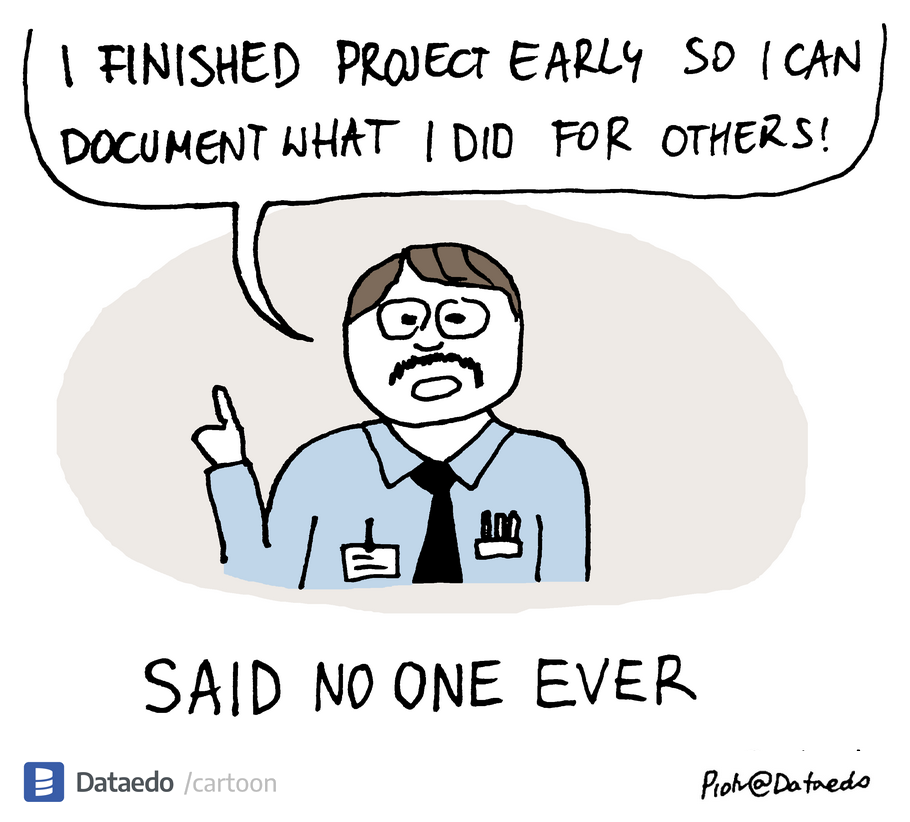{width="80%"}

<small>Source: [dataedo.com/cartoon/lets-document](https://dataedo.com/cartoon/lets-document)</small>
<!--https://dataedo.com/cartoon/lets-document-->
:::
::::

::: {.notes}
You might be convinced about sharing your data, but here is what you maybe actually thinking, this sounds great, but I barely have time to do my research, or you don't know where to start. The gap between inspiring open science talks and your daily reality can feel overwhelming. You're already stretched thin managing your actual research and the idea of organizing everything for others can feel impossible.

As I said, we're going to bridge that gap together with concrete, manageable steps. We're not aiming for perfection - we're aiming for meaningful progress that fits into your real research life.
:::


## When Good Intentions Meet Reality {.center}



<small>Source: [Data Sharing and Management Snafu](https://www.youtube.com/watch?v=N2zK3sAtr-4) by [NYU Health Sciences Library](https://hslguides.med.nyu.edu/data_management) (2013)</small>

::: {.notes}
We are going to watch a video. As you watch this, take a mental note of the number of times you think, "that could be me" or "I've been there." 

Pay attention to things that seemed completely reasonable in the moment but created problems later? And which of these disasters were actually preventable? The goal isn't to criticize these fictional researchers, it's to learn from their experiences so we can build better systems for ourselves.
:::

## Poll: How Familiar Does This Feel? {.center}

::: {.nonincremental}
1. Did you recognize yourself in at least one of the scenarios in the video?
2. What were the preventable failures you saw? Answer in one or two words, e.g., "no documentation," "broken link," "permission unclear."
:::

::: {.notes}
Alright, let's get a quick read of the room. Did you recognize yourself in at least one of those scenarios? Did it make you a tiny bit anxious about your own data practices? Okay, it looks like we're not alone in this. This shared anxiety is exactly why we're here today.

Now, let's move from feeling to diagnosis. I want you to name the preventable failures you saw. What were the root causes? Think 'no documentation,' 'broken link,' 'permission unclear.' Just one or two words per entry. Take two minutes to capture the patterns you noticed.

I was hoping that you would identify these patterns like you did, documentation gaps, access problems, format issues, legal/permission confusion, and discoverability failures. These aren't unique problems; they are predictable challenges. And with your own experience, you just diagnosed the exact problems the FAIR principles were designed to solve.
:::


## FAIR Principles {.center}
:::: {.columns}

::: {.column width="60%"}

2014: Researchers from different fields meet in Leiden
*"We're all having the SAME problems with data"*

<br>

2016: FAIR principles published [@wilkinsonFAIRGuidingPrinciples2016]
:::

::: {.column width="40%"}

Today: You're here because:

::: {.incremental .smaller}
- Your funder requires it (or will soon)
- You've lost data/time to chaos
- You want to do better science
:::
:::

::::

::: {.notes}
Looking  at the patterns emerging in your responses, similar themes appear, regardless of the disciplines represented in the room. These problems are so universal that in 2014, researchers from fields as different as astronomy, biology, and social science met and realized they were all struggling with identical fundamental issues.

I think it's important to know that FAIR principles weren't created by administrators, librarians, or IT departments trying to impose more requirements on researchers. They were developed by working researchers who were frustrated with losing data, time, and opportunities due to these recurring problems.

The 2014 workshop in Leiden brought together physicists, biologists, social scientists, and researchers from many other fields, all saying essentially the same thing: "These data management problems are seriously hurting our productivity and the impact of our research." The principles they published in 2016 have become widely adopted precisely because they work, they solve real problems that researchers actually experience every day.

The reason we need this now more than ever? The scale of research data is exploding, collaboration is increasingly global, and the cost of lost or unusable data keeps growing. Plus, if you're applying for grants or publishing in major journals, you're already being asked about FAIR compliance. The question isn't whether you'll encounter FAIR, it's whether you'll be ready when you do.
:::

## Principles vs. Prescriptions {.center}
### Why FAIR Works

<br>

<table>
  <thead>
    <tr>
      <th><strong>Standards Tell You HOW</strong></th>
      <th><strong>Principles Tell You WHAT</strong></th>
    </tr>
  </thead>
  <tbody>
    <tr style="font-size: smaller;">
      <td class="fragment" data-fragment-index="1">Use metadata schema X</td>
      <td class="fragment" data-fragment-index="2">Make data <strong>Findable</strong></td>
    </tr>
    <tr style="font-size: smaller;">
      <td class="fragment" data-fragment-index="3">Store in repository Y</td>
      <td class="fragment" data-fragment-index="4">Make data <strong>Accessible</strong></td>
    </tr>
    <tr style="font-size: smaller;">
      <td class="fragment" data-fragment-index="5">Use format Z</td>
      <td class="fragment" data-fragment-index="6">Make data <strong>Interoperable</strong></td>
    </tr>
    <tr style="font-size: smaller;">
      <td class="fragment" data-fragment-index="7">Include license X</td>
      <td class="fragment" data-fragment-index="8">Make data <strong>Reusable</strong></td>
    </tr>
    </tr>
  </tbody>
</table>


::: {.fragment}
**Principles provide flexibility:** you decide the best way to achieve them given your context
:::

::: {.notes}
Here's why FAIR caught on so quickly. It is because they define principles, not another set of rigid standards.

A standard says 'use this specific metadata format.' A principle says 'make your data findable.' A standard says 'store in repository X.' A principle says 'make it accessible.' See the difference?

This matters because your sensitive human subjects data needs a completely different approach than someone's computational models. FAIR doesn't force you into a one-size-fits-all solution. It gives you the goals, findable, accessible, interoperable, reusable and lets you figure out the best way to get there given your constraints.

That's why it works across every field represented in this room.
:::


# Part II: Making FAIR Tangible {.center background-color="#00883A"}
*From abstract principles to concrete actions*

## Managed Data, Open Data, FAIR Data {.center}

:::: {.columns}
::: {.column width="55%"}
 (CC BY 4.0)](images/open-data-rdm.png){width="90%" fig-alt="Pyramid of data openness: active data is managed and curated into closed, open with conditions, and fully open tiers, then preserved and published"}
:::

::: {.column width="45%"}
](images/ugent-fair-open.png){width="85%" fig-alt="Venn diagram: FAIR data sits inside managed data, and open data partially overlaps both"}
:::
::::

::: {.notes}
These are related but distinct concepts, and this is the most common confusion I want to clear up before we make FAIR tangible. All your data needs to be managed, stored, and backed up, regardless of whether it will ever be shared. That is the foundation, the base of the pyramid. Some of that data can be curated and published, and as the pyramid shows, published does not have to mean fully open: data can be open with conditions like registration or an embargo, or stay closed for privacy reasons. The circles on the right make the second point: FAIR data lives inside managed data, and it only partly overlaps with open data. Many of you work with sensitive participant data that cannot be fully open, but it can still be well-managed and FAIR: findable through its metadata and accessible under clear conditions, for example through a trusted research environment, which we will see later. So when you hear FAIR today, do not hear "make everything public". Good data management is the foundation everything else builds on.
:::

## FAIR by Design {.center}
:::: {.columns}

::: {.column width="60%"}
](images/fair-principles.svg){fig-alt="Illustration of FAIR principles showing Findable, Accessible, Interoperable, and Reusable concepts" fig-align="center"}
:::

::: {.fragment .column width="40%"}
<br>
...by integrating the FAIR principles into every stage of your research process, from planning to execution to sharing and reuse.
:::

::::


::: {.notes}
Every disaster we saw had a prevention moment much earlier. You already think this way with your experimental design. You don't run an experiment and *then* figure out how to control for confounds. FAIR by design is just applying that same rigorous, proactive thinking to your data management from the very start of a project. And we can achieve FAIR data by design by adopting a Data Life Cycle approach to FAIR.
:::

## Data Life Cycle Approach to FAIR

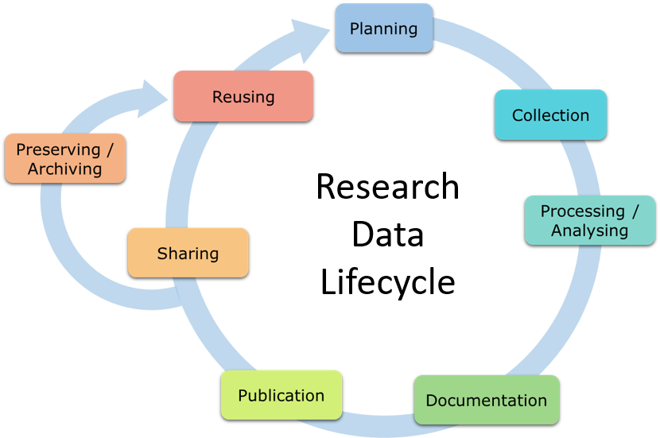

<small>Source: Research data life cycle by Jürgen Rohrwild</small>

::: {.notes}
This is where FAIR research data management by design pays off. Every stage you see here represents a choice point where you can either prevent problems or create them. The researchers in that video didn't fail because they were careless. They failed because they didn't have systematic prevention built into their workflow.

Look at the planning stage: this is where you make foundational decisions, how will you name files consistently? Where will you store data? What backup systems will you use? During collection, you're documenting what each measurement means as you go, not trying to decipher cryptic abbreviations months later. In analysis, you're keeping track of every step and decision, not hoping you'll remember your process when someone asks about it.

By the time you reach sharing, you're not scrambling to figure out permissions or hunting for missing pieces. You're publishing work that was designed from the start to be understood and used by others.

This systematic thinking through each stage is exactly what a document called "Data Management Plan" captures and guides you through.
:::

## Data Management Plans {.center}

A **Data Management Plan (DMP)** captures these decisions for each stage of your project

::: {.callout-tip}
#### Related Materials
Writing a DMP with web-based tools like the Research Data Management Organiser (RDMO): [lmu-osc.github.io/FAIR-Data-Management/dmp.html](https://lmu-osc.github.io/FAIR-Data-Management/dmp.html)
:::

::: {.notes}
Writing a comprehensive data management plan deserves its own session. There are modern tools that make the process manageable, covering collaborators, funder requirements, and institutional compliance. You'll find materials for this at the link on the slide.

Today's focus is different: we're understanding FAIR principles and making concrete decisions using community tools. By the end of today, you'll have chosen a repository for your data type, identified relevant standards for your field, and selected an appropriate license, all using decision tools and community resources we'll explore together.

A DMP then helps you consolidate these decisions into a polished, funder-ready plan. Think of today as your literature review phase: scouting methods and building blocks. Writing the DMP is like writing your actual project proposal, but for data management.

**Instructor Notes**: If your course includes a dedicated DMP session, point to it here.
:::


## The FAIR Data Principles {.smallest}

:::{data-id="FAIR-principles" .nonincremental}
- F1. (meta)data are assigned a globally unique and persistent identifier
- F2. data are described with rich metadata
- F3. (meta)data are registered or indexed in a searchable resource
- F4. metadata specify the data identifier

- A1. (meta)data are retrievable by their identifier using a standardized protocol
- A1.1 the protocol is open, free, and universally implementable
- A1.2 the protocol allows for authentication and authorization where necessary
- A2. metadata are accessible, even when the data are no longer available

- I1. (meta)data use a formal, accessible, shared language for knowledge representation
- I2. (meta)data use vocabularies that follow FAIR principles
- I3. (meta)data include qualified references to other (meta)data

- R1. (meta)data have a plurality of accurate and relevant attributes
- R1.1. (meta)data are released with a clear and accessible data usage license
- R1.2. (meta)data are associated with their provenance
- R1.3. (meta)data meet domain-relevant community standards
:::


::: {.notes}
Alright, here are the official FAIR principles in their full glory. I know this looks like a wall of academic text, but don't panic. You don't need to memorize these.

What I want you to do is just scan through them and notice the language patterns. See how they keep mentioning the same concepts? We're going to spend the next hour turning this abstract framework into concrete tools and decisions you can use immediately.
:::

## The FAIR Data Principles: Metadata Powers Everything {.smallest}

:::{data-id="FAIR-principles" .nonincremental}
- F1. <span style="background-color: #ffe4b5;">(meta)data</span> are assigned a globally unique and persistent identifier
- F2. data are described with rich <span style="background-color: #ffe4b5;">metadata</span>
- F3. <span style="background-color: #ffe4b5;">(meta)data</span> are registered or indexed in a searchable resource
- F4. <span style="background-color: #ffe4b5;">metadata</span> specify the data identifier

- A1. <span style="background-color: #ffe4b5;">(meta)data</span> are retrievable by their identifier using a standardized protocol
- A1.1 the protocol is open, free, and universally implementable
- A1.2 the protocol allows for authentication and authorization where necessary
- A2. <span style="background-color: #ffe4b5;">metadata</span> are accessible, even when the data are no longer available

- I1. <span style="background-color: #ffe4b5;">(meta)data</span> use a formal, accessible, shared language for knowledge representation
- I2. <span style="background-color: #ffe4b5;">(meta)data</span> use vocabularies that follow FAIR principles
- I3. <span style="background-color: #ffe4b5;">(meta)data</span> include qualified references to other <span style="background-color: #ffe4b5;">(meta)data</span>

- R1. <span style="background-color: #ffe4b5;">(meta)data</span> have a plurality of accurate and relevant attributes
- R1.1. <span style="background-color: #ffe4b5;">(meta)data</span> are released with a clear and accessible data usage license
- R1.2. <span style="background-color: #ffe4b5;">(meta)data</span> are associated with their provenance
- R1.3. <span style="background-color: #ffe4b5;">(meta)data</span> meet domain-relevant community standards
:::

::: {.fragment}
**That's metadata in 13 out of 15 sub-principles!**
:::

::: {.notes}
**Speaker Notes:**
Now let's count together how many times the word 'metadata' appears... It's highlighted in yellow throughout. That's metadata in 13 of the 15 sub-principles. Metadata IS the core infrastructure that drives all the FAIR principles.
:::

## What Is Metadata, Really? {.center}

**Poll:** *"In one or two words, what is metadata to you?"*


::: {.notes}
**Speaker Notes:**
So, maybe you must have heard the term "metadata" or maybe you haven't. Let us take a minute and see what you think. Use this poll again to write in one or two words that capture your understanding of metadata. If you haven't heard the term before, simply write "No clue".
 
Pause

Such diverse responses! 'context,' 'documentation,' 'data about data,' 'labels.' One of the reasons metadata can feel so confusing is that you're all right. And this ambiguity is one of the core cause of the gap that exists between FAIR principles and its implementation in research workflows.
:::

## Metadata for Researchers {.center}

](images/metadata-framework.svg)

::: {.notes}
**Speaker Notes:**
So many varied answers in that poll, right? 'Context,' 'documentation,' 'data about data,' 'labels.' This variety is exactly why metadata feels like a moving target with different significance in different contexts. Even when you're aware of FAIR principles, metadata can feel overwhelming and abstract.

This figure tries to categorize metadata in a way that makes most sense to you as researchers. At the top, 'Proper Metadata' - that's the catalog information that repositories need. It's probably what librarians and data engineers mean when they talk about metadata. On the left is 'Soft Metadata', the human context about why your research matters. In the middle is 'Hard Metadata', the technical specifications someone needs to replicate your work. On the right is 'Data Complement', the structural description of your recorded data itself.

And you don't need to tackle all of this at once. The lifecycle approach we just saw tells you when to focus on what. With the FAIR aware research data cycle, you would build up metadata systematically as you move through your research process: soft metadata during planning, hard metadata during collection and analysis, data complement as you organize files, and proper metadata when you're ready to share.

These different levels work differently to support the FAIR principles. We'll keep referring back to this framework throughout the workshop so you know exactly what to focus on at each stage, making metadata feel concrete and manageable instead of overwhelming.
:::

## The FAIR Data Principles {.smallest}

:::{data-id="FAIR-principles" .nonincremental}
- F1. (meta)data are assigned a globally unique and persistent identifier
- F2. data are described with rich metadata
- F3. (meta)data are registered or indexed in a searchable resource
- F4. metadata specify the data identifier

- A1. (meta)data are retrievable by their identifier using a standardized protocol
- A1.1 the protocol is open, free, and universally implementable
- A1.2 the protocol allows for authentication and authorization where necessary
- A2. metadata are accessible, even when the data are no longer available

- I1. (meta)data use a formal, accessible, shared language for knowledge representation
- I2. (meta)data use vocabularies that follow FAIR principles
- I3. (meta)data include qualified references to other (meta)data

- R1. (meta)data have a plurality of accurate and relevant attributes
- R1.1. (meta)data are released with a clear and accessible data usage license
- R1.2. (meta)data are associated with their provenance
- R1.3. (meta)data meet domain-relevant community standards
:::

::: {.notes}
**Speaker Notes:**
Let us have another look at the principels again. There is a lot of jargon like “globally unique”, “searchable resource” that might feel like you need a computer science degree!! Let’s colour code it,
:::

## The FAIR Data Principles {.smallest}

:::{data-id="FAIR-principles" .nonincremental}

- **F1**. <span style="background-color: #ffe4b5;">(meta)data</span> are assigned a <span style="background-color: #ffcccc;">globally unique and persistent identifier</span>
- **F2**. data are described with <span style="background-color: #ffe4b5;">rich metadata</span>
- **F3**. <span style="background-color: #ffe4b5;">(meta)data</span> are <span style="background-color: #ffcccc;">registered or indexed in a searchable resource</span>
- **F4**. <span style="background-color: #ffe4b5;">metadata</span> specify the <span style="background-color: #ffcccc;">data identifier</span>

- **A1**. <span style="background-color: #ffe4b5;">(meta)data</span> are retrievable by their <span style="background-color: #ffcccc;">identifier</span> using a <span style="background-color: #ffcccc;">standardized protocol</span>
- **A1.1** the protocol is <span style="background-color: #ffcccc;">open, free, and universally implementable</span>
- **A1.2** the protocol allows for <span style="background-color: #ffcccc;">authentication and authorization</span> <span style="background-color: #cce5ff;">where necessary</span>
- **A2**. <span style="background-color: #ffe4b5;">metadata</span> are <span style="background-color: #cce5ff;">accessible</span>, even when the data are no longer available

- **I1**. <span style="background-color: #ffe4b5;">(meta)data</span> use a <span style="background-color: #ffe4b5;">formal, accessible, shared language for knowledge representation</span>
- **I2**. <span style="background-color: #ffe4b5;">(meta)data</span> use <span style="background-color: #ffe4b5;">vocabularies</span> that follow FAIR principles
- **I3**. <span style="background-color: #ffe4b5;">(meta)data</span> include <span style="background-color: #cce5ff;">qualified references</span> to other <span style="background-color: #ffe4b5;">(meta)data</span>

- **R1**. <span style="background-color: #ffe4b5;">(meta)data</span> have a <span style="background-color: #cce5ff;">plurality of accurate and relevant attributes</span>
- **R1.1**. <span style="background-color: #ffe4b5;">(meta)data</span> are released with a <span style="background-color: #cce5ff;">clear and accessible data usage license</span>
- **R1.2**. <span style="background-color: #ffe4b5;">(meta)data</span> are associated with their <span style="background-color: #cce5ff;">provenance</span>
- **R1.3**. <span style="background-color: #ffe4b5;">(meta)data</span> meet <span style="background-color: #cce5ff;">domain-relevant community standards</span>
:::

::: {.fragment}
**Focus on the blue and metadata, adopt what exists, and let repositories handle the workings of the red**

Source: Adapted from @SoWhyGo2023
:::

<!-- ::: {.fragment .smallest}

- <span style="background-color: #ffe4b5;">Metadata (orange)</span>: Metadata (as machine-readable as possible) is the core - describe your data well
- <span style="background-color: #ffcccc;">Technical Infrastructure (red)</span>: NOT your job - handled by repositories and IT teams
- <span style="background-color: #cce5ff;">Social Decisions (blue)</span>: Your responsibility - choices about access, standards, and documentation
::: -->


::: {.notes}
**Speaker Notes:**
The parts in red are the Technical infrastructure. This is the deep-level IT stuff, like server protocols.
And the parts in blue are Social decisions. These are the agreements and choices that you, your lab, or your entire research community make.
Here’s the key takeaway I want you to remember: You do not have to build this entire system yourself.
Let's start with what you can safely ignore. The red parts - the technical infrastructure - that’s the job of your repository. When you upload your data to a platform like Zenodo or a specialized institutional repository, they handle the standardized protocols. So, you can cross that off your worry list.
Now, let's talk about the orange bits. This is where I see most researchers get stuck. They see 'vocabularies', 'community standards', 'formal language' and think, 'Do I have to invent one of these?'
The answer is an emphatic NO.
Your job is not to create these standards. Your job is to choose one.
Think of it like citing a paper. You don't invent a new citation style every time you write; you choose an existing one like APA or MLA. It’s the same here. So, the big message for everything you see in orange is: Don’t invent, adopt. Choose the tools and standards your community already values. This single decision will take care of most of the interoperability and reusability principles.
Okay, so if the repository handles the red stuff, and you just need to choose the orange stuff, where should you focus your energy?
You should focus your energy right here, on the blue parts and on using those orange standards to create great metadata.
The blue parts are the 'Social Decisions'. These are the key choices where you, the researcher, have the most control and responsibility


ALTERNATIVE

First, look at everything highlighted in light red. This is the Technical Infrastructure.

Think of things like globally unique and persistent identifiers, standardized communication protocols, and authentication. This is the deep-level IT stuff, the plumbing of the internet that makes data sharing possible.

This is not your job.

When you choose a good data repository, like Zenodo, Dryad, or your own institutional repository, they handle all of this for you. They create the persistent identifiers, they manage the servers, and they use the standard protocols. So, you can mentally check off all the red parts. That's the repository's responsibility.

Next, let's look at the orange parts. This is where I see most researchers get stuck. They see phrases like formal, accessible, shared language and vocabularies that follow FAIR principles, and they panic, thinking, 'Do I have to invent a new language for my data?'

The answer is an emphatic NO.

Your job is not to create these standards. Your job is to choose and adopt the ones your research community already uses and values.

Think of it like citing a paper. You don't invent a new citation style every time you write a manuscript; you choose an existing one like APA, MLA, or Vancouver. It’s the same principle here. For describing a variable, a method, or a sample, you find and use the established vocabulary or format for your field.

So, the big message for everything you see in orange is: Don’t invent, adopt. This single decision to use community standards will take care of most of the 'Interoperability' and 'Reusability' principles for you.

So, if the repository handles the red stuff, and you just adopt the orange stuff, where should you focus your energy?

You should focus your energy right here, on the blue parts, the Social Decisions, and on using those orange standards to create rich, machine-readable metadata.

This is where you, the subject matter expert, are irreplaceable. This is your core contribution to making your data FAIR.

Let's connect this to the diagram on the slide. Your job is to tell the story of your data. And tell it in a way that not just humans but machines can also understand it, that is, again machine readable metadata, that is the hard and soft metadata from the framework before.

As for the "Proper Metadata", make sure you record it well and make available completely when needed by your data sharing platform of choice.

In addition, The blue items on the FAIR list are the practical decisions you make to capture this story:

Choosing a clear and accessible data usage license (R1.1).

Describing the data's origin and history, or provenance (R1.2). This includes maintaining the data and metadata as a living object, updating it and not abandoning it.

This is your focus: using the tools and standards your community provides to accurately and thoroughly describe your science, so that both a person and a computer can understand not just what the data is, but how and why it came to be.
:::

## Your Three-Part Action Plan {.center}

Based on what's actually your responsibility:

1. **Adopt Recommended Tools & Standards**:
Adopt the recommendations from today and/or find and use what your field already created

2. **Document Your Data Well**:
Create README, methods, and data dictionary

1. **Make Key Decisions**:
Repository, license, organization, format, sharing level

. . .

**That's it. Everything else is handled by the tools you choose.**


::: {.notes}
Strip away all complexity, and your job has three parts. First, find and adopt standards your field already uses - don't reinvent. Second, document your data well - only you can explain your research. Third, make five key decisions about where and how to share. That's literally it. Everything else is automated by the tools and standards you choose. Now, let's make each part concrete.
:::


# Part III: Managing Data for Your Future Self and Collaborators {.center background-color="#00883A"}
**Creating FAIR Research Data**

## Files and Folders: Everyday Practices {.center}

:::: {.columns}

::: {.column width="50%"}
Research data management can be chaotic

- Inconsistent file naming
- Disorganized folder structures
- Missing documentation
- Confusion about versions
- Lost files and wasted time
:::

::: {.column width="50%"}
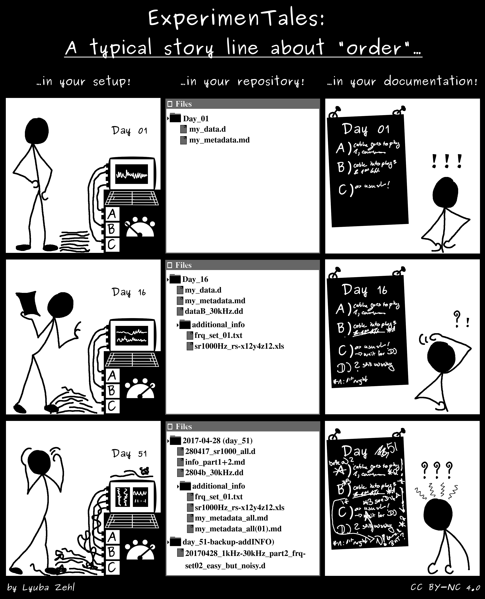{height="560"}

<small>Source: [ExperimenTales by Lyuba Zehl](https://gin.g-node.org/lzehl/ExperimenTales) (CC BY 4.0)</small>
:::

::::

:::{.notes}
Research is messy and so is data. But some mess is preventable. Look at this comic. How many of you have seen something like this in your own work? The chaos of inconsistent file names, random folder structures, and missing documentation isn't just annoying; it creates real barriers to reusing data later or sharing it with others. So although this may feel like a tedious and unglamorous task, taking the time to organize your files and folders properly is an investment in the future usability of your data. And ideally this organization should be established at the beginning of your project, not as an afterthought.
:::

## Folder Structure {style="font-size: 0.6em;"}
:::: {.columns}

::: {.column width="60%"}
::: {.fragment}
- Check whether research group level conventions exists
- If not, create and DOCUMENT a simple, consistent folder structure
:::

::: {.fragment}
You may set it up a folder structure by:
:::

::: {.fragment}
- Data type (text, images, models, etc.)
- Time (year, month, session, etc.)
- Project phase (planning, execution, analysis, etc.)
- Experimental run
- Subject (e.g., species, sample type)
- ..etc.
:::

::: {.fragment}
...there is no one right answer. 
:::

::: {.fragment}
**Take a decision, document it and be consistent.**
:::
:::

::: {.column width="40%"}
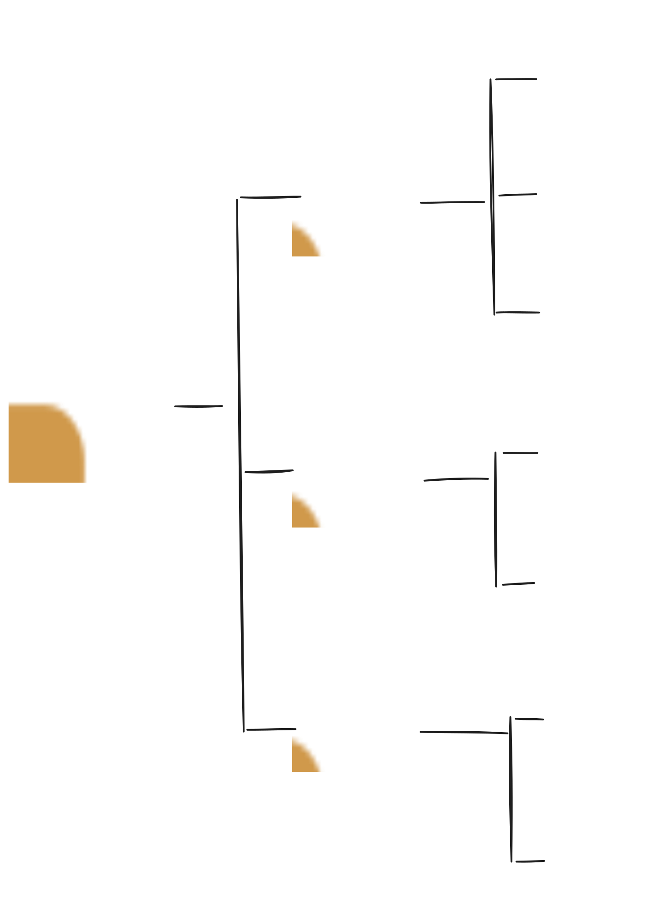{height="560"}
:::

::::

## Example Folder Structure {.center .smaller}
```
.
├── 01_data/                # All project data
│   ├── raw/                # Original, immutable data (do not modify)
│   ├── external/           # Data from outside sources (e.g., public datasets)
│   ├── processed/          # Cleaned/transformed data (outputs from scripts)
│   └── README.md           # Data sources, descriptions, processing steps
├── 02_analysis/            # Analysis scripts and utilities
│   ├── 01_data_cleaning.R  # Example: data cleaning script (R)
│   ├── 02_exploratory_analysis.py # Example: exploratory analysis (Python)
│   ├── 03_modeling.R       # Example: modeling script (R)
│   ├── utils/              # Reusable functions or modules
│   └── README.md           # Analysis workflow and script purposes
├── 03_manuscript/          # Manuscript drafts, figures, documents
│   └── README.md           # Track manuscript progress, submission plans, authors
├── 04_presentation/        # Materials for talks, posters, slides
│   └── README.md           # Summarize presentations (title, date, format)
├── 05_misc/                # Supplementary files (proposals, notes, etc.)
│   └── README.md           # Describe contents
└── README.md               # Project overview and setup instructions
```

Reuse this template from: [https://github.com/lmu-osc/research-project-template](https://github.com/lmu-osc/research-project-template)

::: {.notes}
This is one such example of a well-organized project structure. Each main directory has a clear purpose, and the use of subdirectories helps keep related files organized. The README files in each directory serve as a guide for anyone who might work with the project in the future, making it easier to understand the project's organization and workflow. Note that this is a project folder structure, not a repository structure. When you share your data, you might only share the '01_data' folder with its subfolders and README, depending on what is relevant for reuse.
:::

## File and Folder Naming

::: {.fragment}
The goals of a good naming convention would be:
:::

::: {.fragment}
- identify the content of a (data)file without opening it
- enable easy searching and filtering
- include relevant metadata (e.g., date, version)
- be consistent and predictable
:::


::: {.fragment}
...again, there is no one right answer.
:::

<br>

::: {.fragment}
**Take a decision, document it and be consistent.**
:::

## Take a decision, document it and be consistent. {.center}

<br>

::: {.fragment}
There are no right answers here, only trade-offs.
:::

<br>

::: {.fragment}
... but, there are some **best practices** that will prevent some common pitfalls
:::

---

## Best Practices: What We've Learned from Collective Pain {.center .smallest}

::: {.fragment}
- don't use spaces, periods, hyphens or other special characters & , * % # ; * ! @$ ^ ~ ' { } [ ] ? < >.(including language-specific characters) in names
  - use underscores (_) or camelCase instead
- limit the filename to 32 characters
- avoid deep folder hierarchies
- write dates and numbers in standardized formats, use zero padding to get easily readable file listings
  - e.g., YYYY-MM-DD for dates, 001 for numbers
- use consistent patterns for similar types of files
- separate raw data from processed data to ensure raw data is never altered
:::

::: {.fragment}
**If you can't find it in 30 seconds, your system needs work.**
:::

::: {.fragment}
**If a computer can't follow your pattern, you're creating future work.**
:::

::: {.notes}
These are practical best practices that solve real problems researchers encounter. Let's walk through the key ones on the slide.

Avoiding spaces and special characters prevents headaches when files need to work across different systems: what looks fine on your Mac might break on a colleague's Windows machine or a computing cluster. The 32-character limit keeps filenames readable and prevents truncation issues. Keeping folder structures reasonably flat makes navigation easier, especially as projects grow. Using standardized formats like YYYY-MM-DD for dates ensures files sort chronologically, and zero-padding numbers does the same for sequences.

The bigger picture here is consistency. When you establish predictable patterns, you're not just helping future you find files. You're also making it possible for software to automatically organize and process your work. Think of it like creating a filing system that both humans and computers can follow.

Two practical benchmarks to keep in mind: if you can't find a specific file in 30 seconds, your naming system needs work. And if a computer couldn't follow your organizational pattern to automatically work through your files, you're creating unnecessary future work for yourself and your team.
:::


## Files and Folders: Versioning {.smaller}

:::: {.columns}
::: {.column width="32%"}
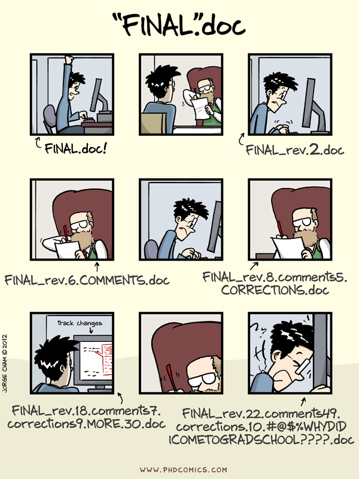{width="70%"}

<small>Source: [PhD Comics](https://phdcomics.com/) © Piled Higher and Deeper Publishing</small>
:::

::: {.column width="60%"}
- Establish a versioning strategy
- Use clear, consistent naming conventions for versions (e.g., `v1`, `v2`, etc.)
- Document changes in a changelog file
- **Automate versioning with tools like Git**
:::
::::

::: {.callout-tip .fragment}
##### Related Materials
[Introduction to Git](https://lmu-osc.github.io/teaching-material-for-novices/open-research-tools/git/) and [GitHub](https://lmu-osc.github.io/teaching-material-for-novices/open-research-tools/github/)
:::

::: {.notes}
**Speaker Notes:**
Even with consistent naming, projects naturally accumulate versions, and that's where things can get messy fast. Without a clear versioning strategy, you end up with folders full of files that track every iteration, making it hard to know which version is current or how you got there.

The simplest approach is systematic version numbers: `data_v1.csv`, `data_v2.csv`, and so on. Pair this with a changelog file that explains what changed in each version. It takes two minutes to write but saves hours of detective work later when you're trying to remember why you made certain changes.

To make this easier, version control tools like Git can automate much of this tracking. Git handles the technical details of storing changes and lets you easily compare versions or roll back when needed. The Git and GitHub materials linked on the slide show how it works in practice for research workflows.
:::


## File Formats: Strategic Trade-offs {.center}

:::: {.columns}
::: {.column width="60%"}
Ideally, your format would be...

- ...readable by humans with a simple editor
- ...readable with many programs
- ...easy to understand, low complexity
- ...small (storage space)
- ...quick to read (performance)

:::

::: {.column width="40%"}
::: {.fragment}
But usually you have to choose between...
:::
- performance (binary) vs accessibility (text)
- features (Excel) vs universality (CSV)
- convenience (today) vs longevity (decades)
:::
::::
::: {.notes}
File formats are the backbone of data interoperability. When you choose a format, you're making decisions about who can access your data and for how long. The ideal format would be readable by humans, work with many programs, have clear documentation, use minimal storage, and perform well. But reality requires compromises.

Binary formats like SPSS files are efficient during active research but may become unreadable if the company disappears. CSV files are less efficient but will likely be readable in 50 years. The key is understanding these trade-offs and making intentional choices.
:::

## File Format Decisions {.center .smaller}

:::: {.columns}
::: {.column width="40%"}
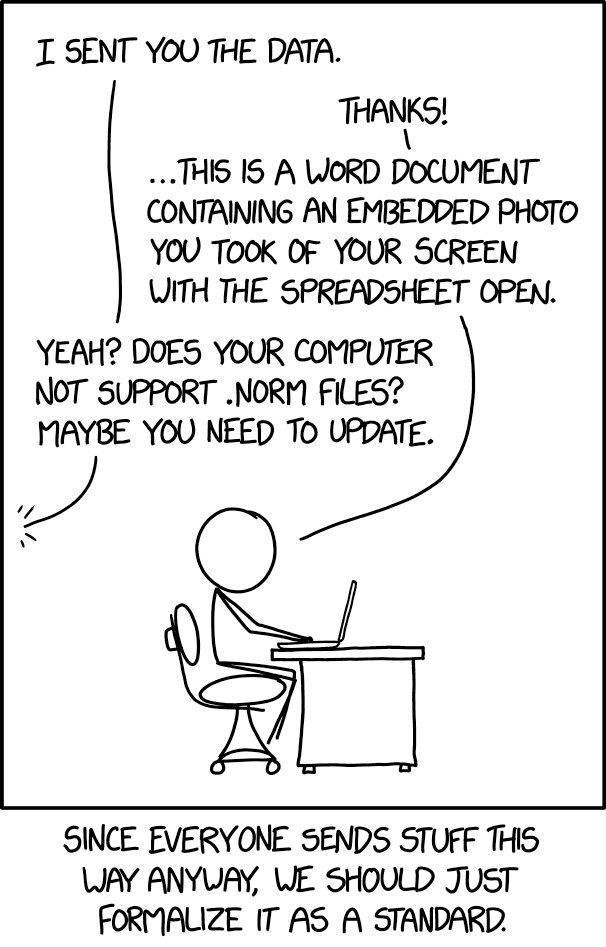{width="55%"}

<small>Source: [xkcd.com/2116](https://xkcd.com/2116/) (CC BY-NC 2.5)</small>
:::
::: {.column width="60%"}
::: {.fragment}
**Use proprietary formats for work if needed, but convert to open formats for sharing and archiving**
:::
::: {.fragment}
Why avoid closed proprietary formats?
:::
- undocumented specifications
- single software dependency
- company control over access
- hidden metadata risks
- long-term obsolescence
  
:::
::::

::: {.fragment}
Softwares may change, but your data survives
:::


::: {.notes}
Proprietary formats create dependency on specific companies and software. When companies change business models, discontinue products, or disappear entirely, your data can become inaccessible. The formats often lack proper documentation because companies want to maintain competitive advantage.

Open formats have publicly available specifications that multiple software packages can implement. Even if one program stops supporting a format, others can continue to read it. This is especially critical for long-term data preservation.
:::


## Recommended Formats by Use Case {.center .smallest}

:::: {.columns}
::: {.column width="50%"}
::: {.fragment}
Documentation

- **Plain text** (.txt)
- **HTML, XHTML, Markdown** 
- **PDF/A-1** - archival standard
- *Maybe*: RTF (.rtf), ODT (.odt), docx
:::
::: {.fragment}
Tabular Data

- **CSV** - comma-separated values
- **TSV** - tab-delimited
- *Maybe*: ODS (.ods), xlsx
:::
:::

::: {.column width="50%"}
::: {.fragment}
Nested Data

- **JSON** - structured, web-friendly
- **YAML** - human-readable, structured
- **XML** - complex hierarchies
:::
::: {.fragment}
Further formats

- **NetCDF, HDF5** - self-describing
- **PNG, JPG** - images
- **Domain-specific standards**
:::
:::
::::

::: {.fragment}
**Start with bold formats, fall back to "maybe" formats only if needed**
:::

::: {.notes}
Start with the bold formats - these have the best long-term prospects and widest software support. While all formats have obsolence issues, Plain text and CSV will likely be readable in 50 years. 

The "maybe" formats aren't forbidden, but use them strategically. Excel files are convenient for active work but convert to CSV for sharing. Word documents are fine for drafts but consider PDF/A-1 or Markdown for final versions.

NetCDF and HDF5 are scientific formats they're self-describing, which means the metadata travels with the data. For images, PNG is lossless while JPG is fine for photos but avoid it for diagrams or charts where compression artifacts matter.

Remember: your choice today determines whether someone can use your data in 2045. Choose the format that maximizes long-term accessibility, not just current convenience.
:::

## Data Storage: Keeping Your Work Safe {.center .smaller}

:::: {.columns}
::: {.column width="60%"}
::: {.fragment}
**Use institutional storage as much as possible**
:::

::: {.fragment}
##### Follow the 3-2-1 Backup Rule
- **3** copies of important data
- **2** different storage types
- **1** copy stored off-site
:::

::: {.fragment}
**Raw data is irreplaceable, treat it with care**
:::

:::

::: {.column width="40%"}
::: {.fragment}
##### Test Your Backups
- Try restoring a file periodically
- Verify files still open correctly
:::

::: {.fragment}
##### Storage Hierarchy
- Local: temporary files only
- Network: active project data
- Off-site: disaster protection
:::
:::
::::


## Data Dictionary: Making Numbers Meaningful {.center .smaller}

:::: {.columns}
::: {.column width="50%"}
```csv
id,age,score,group,time
1,34,7.2,A,1250
2,28,5.1,B,890
3,41,8.9,A,1455
4,37,6.3,B,1100
```
::: {.fragment .nonincremental}
- Just numbers in cells
- "Obviously" meaningful to you
- Gibberish to everyone else
- Scientific value = minimal
:::
:::

::: {.column width="50%" .fragment}
```
id: Participant ID (001-150)
age: Age in years at testing
score: Beck Depression Index (0-10)
group: Treatment (A=CBT, B=control)
time: Reaction time in milliseconds
```
::: {.fragment .nonincremental}
- Units, ranges, conditions defined
- Measurement protocols clear
- Valid values specified
- Reusable across contexts
:::
:::
::::

::: {.fragment}
**Data dictionaries capture the unavoidable details that transform digits into science.**
:::

::: {.notes}
This addresses the data complement from our metadata framework,the unavoidable details that distinguish meaningful data from random numbers. Without this context, your perfectly organized numbers could be temperature, blood pressure, or reaction time, and there's no way for others to know.

Data dictionaries capture what makes your quantitative values scientifically meaningful: units, measurement conditions, valid ranges, equipment specifications, and processing steps. This isn't bureaucratic documentation, it's what transforms digital files into reusable scientific resources.

There are practical tools for creating data dictionaries, but the key insight is timing: start building this as you collect data. The context that seems obvious now becomes impossible to reconstruct months later when you're staring at a file called "temp_final_adj.csv" with no memory of what adjustment you made.
:::

## Hard Metadata: Can somebody replicate this? {.center .smaller}

:::: {.columns}

::: {.column width="60%"}
::: {.fragment}
The methodological details that determine whether your scientific findings can be replicated
:::

::: {.fragment .incremental .smallest}
- What equipment you used (exact models)
- How you calibrated it (specific procedures)
- When you collected data (dates, times, conditions)
- Why you made specific methodological choices
- Which software versions and settings
- Where raw data came from and how it was processed
:::
:::

::: {.column width="40%"}
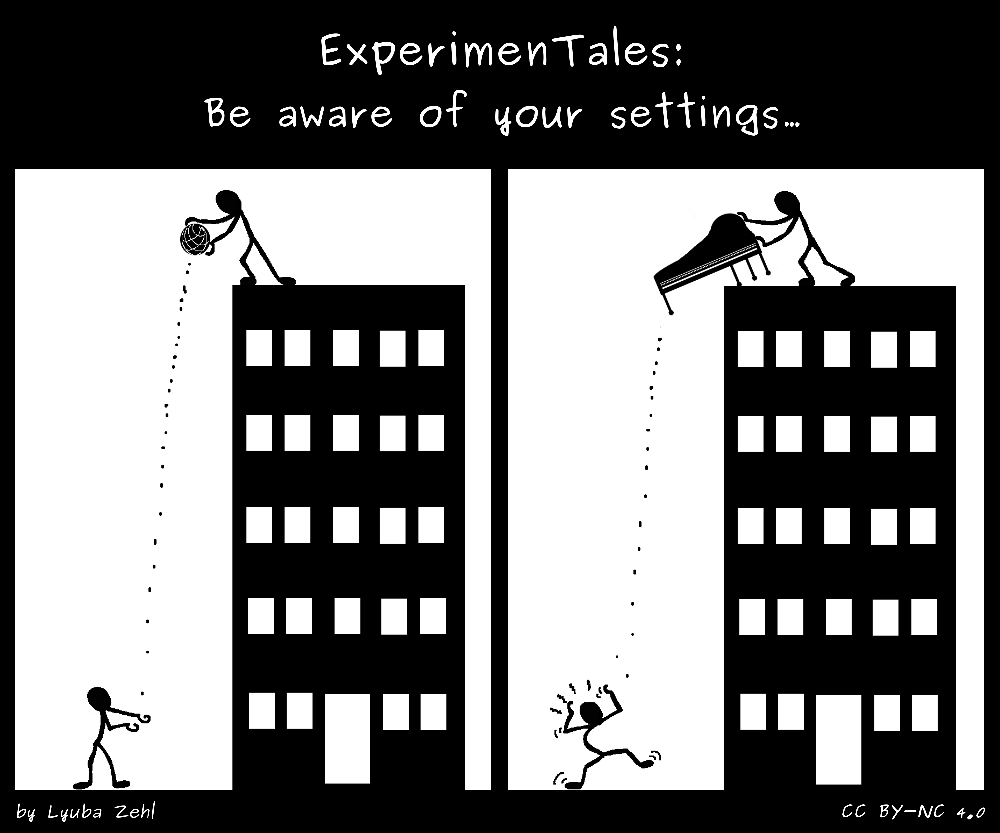{fig-align="center"}

<small>Source: [ExperimenTales by Lyuba Zehl](https://gin.g-node.org/lzehl/ExperimenTales) (CC BY 4.0)</small>
<!-- https://gin.g-node.org/lzehl/ExperimenTales/raw/master/stories/experimentales-003/experimentales-003_be-aware-of-your-settings.png -->
:::

::::

::: {.notes}
This is where we get to the heart of scientific rigor. Hard metadata captures the methodological backbone that makes replication possible. Whether you're using visual stimuli in psychology, survey instruments in sociology, lab protocols in biology, or computational models in economics, there are always critical details that seem obvious to you but are invisible to others.

The practical question is simple: sit with your current project and ask yourself honestly, "Can somebody replicate this?" If the answer makes you uncomfortable, that's your signal to strengthen your hard metadata documentation.
:::

## Example Hard Metadata Elements: Biology/Medicine {.center .smaller}

::: {.fragment}
- Samples: Collection time, storage temperature, handling procedures
- Equipment: Calibration data, model numbers
- Reagents: expiration dates, storage conditions, identifiers
- Protocols: Timing, volumes, temperature, order of operations
:::

::: {.fragment}
**Would a competent researcher in your field be able to replicate your study from your metadata alone?**
:::

::: {.notes}
**Speaker Notes:**
Think about your current research: Could someone else recreate your exact experimental setup? Do they know which version of that questionnaire you used, how you calibrated your equipment, what your sampling criteria were? These details are the foundation of scientific reproducibility.

The reproducibility test is straightforward but demanding: If you handed your metadata to a competent researcher in your field, could they replicate your study without needing to ask you any clarifying questions? This is the gold standard we should aim for in our documentation. This is essentially the same as the "Methods" section of a paper, but often needs to be more detailed and specific to ensure full reproducibility.
:::

## Methods Section and Hard Metadata {.center .smaller}

:::: {.columns}
::: {.column width="50%"}
Journal Methods Section:

::: {.fragment}
"Participants completed questionnaires in a quiet laboratory setting. Data were collected 
using Qualtrics and analyzed using R statistical software."
:::
:::

::: {.column width="50%"}
Hard Metadata You Need to Capture:

::: {.fragment .smallest}
- Questionnaire: Beck Depression Inventory-II, version 2.1 (Beck et al., 1996)
- Environment: Sound-isolated room, 22°C, fluorescent lighting, 10am-4pm sessions
- Platform: Qualtrics XM (version 2024.3), randomization seed: 12345
- Software: R 4.3.2, tidyverse 2.0.0, lme4 1.1-35
- Computer: Dell OptiPlex 7090, Windows 11 Pro, 1920x1080 display
- Procedure: 15-min consent, 20-min questionnaire, 5-min debrief
:::
:::
::::

::: {.notes}
You might think that the methods section of your paper already covers this, but in practice, journal methods sections are often too brief and lack the necessary detail for full reproducibility. The hard metadata would go deeper, specifying exact versions of software, environmental conditions, and procedural details that are critical for replication. This level of detail ensures that another researcher can follow your exact steps without ambiguity. It's about transforming a general description into a precise blueprint for replication. Again, maybe not all at once, but over time, build this into your workflow.
:::


## READMEs: Can somebody understand this? {.center .smallest}

::: {.fragment}
The human context that bridges your research logic with others' understanding
:::

::: {.fragment}
- Can someone understand why I organized my data this way?
- Would they know what questions drove this research?
- Can they navigate my files without getting lost?
- Do they understand my methodological choices?
- Would they know how to properly cite and use this work?
:::

::: {.notes}
So, READMEs are a place to capture the "soft" metadata from our framework earlier. They are your opportunity to speak directly to future users of your data. While your hard metadata captures the technical details for reproduction, your README captures the human story: the research context, organizational logic, and practical guidance that transforms a collection of files into a usable scientific resource.

Ask yourself: if a researcher in your field stumbled across your dataset six months from now, would they understand not just what you did, but why you did it that way? Your README is the bridge between your internal project logic and external understanding.
:::

## Example README Structure {.center .smaller}

:::: {.columns}
::: {.column width="50%" .fragment}
- Project Overview
- Data Description
- Folder Structure Explanation
- Methodological Context
- Usage Notes
- Citation Information
- Contact Information
- Acknowledgments
:::
::: {.column width="50%" .fragment .nonincremental}
- [Example 1 - Atmospheric Science](https://github.com/lmu-osc/FAIR-Data-Management/blob/main/Example1_READMETemplate.md)
- [Example 2 - Social Science](https://github.com/lmu-osc/FAIR-Data-Management/blob/main/Example2_READMETemplate.md)
- [Example 3 - Neuroscience](https://github.com/lmu-osc/FAIR-Data-Management/blob/main/Example3_READMETemplate.md)
- [Example 4 - Psychology](https://github.com/lmu-osc/FAIR-Data-Management/blob/main/Example4_READMETemplate.md)
:::
::::

## Proper Metadata: Can somebody find this? {.center .smaller}

**The catalog information that makes your research discoverable**


:::: {.columns}
::: {.column width="50%"}
- Who created the dataset?
- What do the data files contain?
- When was the dataset generated?
- Where was the dataset generated?
- Why was the dataset generated?
- How was the dataset generated?
:::
::: {.column width="50%"}
- What research is this dataset connected to?
- Can this dataset be reused?
- What keywords describe this dataset? 
:::
::::


::: {.notes}
This is where we address the "proper metadata" from our framework, the information that helps your research get discovered in the first place. Think about it: you've done excellent science, documented it thoroughly, but if people can't find it when they search, all that work stays invisible.

These questions shift the focus from filling out forms to helping users. Can researchers identify who created this and their background? Do they understand what's actually in your data files? Can they tell if the time period and location fit their needs? Do they grasp why you created this dataset and how it connects to your research?

Repositories guide you through this process with forms that prompt you for the right information. But the strategic thinking, choosing keywords that your community actually uses, writing titles that clearly communicate your contribution, that's where your expertise matters most.

For instance, a title like "Study 1 Data" tells potential users nothing about who, what, when, where, why, or how of the dataset. Keywords that match how your community actually talks about this research area: that's what connects your work to the people who need it.

Think about your own search behavior. When you're looking for existing datasets, what information helps you quickly decide if something is relevant? You want to know who created it, what's in it, when it was made, where it came from, why it exists, and how to use it. Apply that same logic to how you describe your own work.

To think about this, you would go to your field's main repository or search engine, search for the kind of research you've done, and see if your dataset would actually show up in those results. If not, you know what needs work.
:::

## Activity: Quiz {.center}

::: {.nonincremental}
- Each question has only **one correct** answer
- Feel free to use an **alias name, your name or abstain**
- There is **no time limit**, but try to answer intuitively, we will try to give 15 seconds per question
:::

## Quiz: Answers

::: {.panel-tabset}

### Question 1

A historian is digitizing letters from an archive. Which **file naming convention** is the most FAIR-friendly for a **letter written on January 15, 1890**?

::: {.nonincremental .smaller}
a. First Scan (Important!).jpg

b. Letter from Jane.jpg

c. Jane Smith letter to Robert Doe scan Jan15.jpg

d. 1890-01-15_smith-j_to_doe-r.jpg ✅

:::

### Question 2

A biologist is saving **tabular data** from a lab instrument. For long-term preservation and sharing, which **file format** is the best choice?

::: {.nonincremental .smaller}
a. A screenshot of the table (.png)

b. Microsoft Excel (.xlsx)

c. Comma-Separated Values (.csv) ✅

d. A table in a PDF document (.pdf)

:::

### Question 3

What is the **primary benefit** of using a logical **folder structure** (e.g., having separate folders for 'data', 'code', and 'manuscripts') for your project?

::: {.nonincremental .smaller}
a. It encrypts the data to make it more secure.

b. It makes the project easier for you and others to navigate and understand. ✅

c. It makes the total project file size smaller.

d. It reduces the number of files you need to create.

:::

### Question 4

A political scientist has a dataset with a **column labeled 'Pol_Aff'**. The values are **'1', '2', or '3'**. **Without a 'data dictionary'** or 'codebook', this column is not reusable. Why?

::: {.nonincremental .smaller}
a. Because the column name is too short.

b. Because the data should have been stored as text instead of numbers.

c. Because nobody knows what the codes '1', '2', and '3' actually represent. ✅

d. Because the numbers are not in a machine-readable format.

:::

### Question 5

Which of the following is an example of **'metadata'** you might create for an **audio file** of a sociological **interview**?

::: {.nonincremental .smaller}
a. A separate text file listing the interview date, location, duration, and topics discussed. ✅

b. The software application used to play the audio file.

c. A password used to encrypt the audio file.

d. The raw audio waveform of the interview itself.

:::

### Question 6

You return to a complex research project a year after last working on it. Which single document would be most helpful to **quickly understand the project's layout, contents, and how the files relate** to each other?

::: {.nonincremental .smaller}
a. The final published article or report.

b. The script or code used for the final analysis.

c. A 'README.txt' file in the main project folder. ✅

d. The folder containing the raw, unprocessed data.

:::

### Question 7

A social scientist is creating a spreadsheet of interview participants. One column, **'Demographics'**, contains entries like **'Female, 34, PhD'**. Why is this a problematic way to organize the data?

::: {.nonincremental .smaller}
a. It makes the file size unnecessarily large.

b. It is not problematic; it's an efficient way to enter data quickly.

c. It combines multiple variables (gender, age, education) into a single column, making it impossible to sort or filter the data by just one of those variables. ✅

d. It uses text instead of numerical codes, which is always wrong.

:::

:::

::: {.notes}
**Instructor Notes**: Interactive quiz to check understanding of Part III. Set up these questions in a polling tool such as [Particify](https://www.particify.de/en/) and show the tabs only after learners have answered. Guidance on interpreting the results:

- If more than 80% of the learners select the correct response option, show which one it is and move on.

- If less than 80% of answers are correct, let them discuss with each other for 1-2 minutes which one they selected, and why, and afterwards let them re-take the question. If they're above 80% correct the second time, move on, else show the correct response and explain why it is correct (plus maybe why the others are not).

- If more than 30% select a specific distractor answer, discuss it in class.
:::


# Part IV: Creating Research Data for Unexpected Reuse {.center background-color="#00883A"}
**Making Data Interoperable & Reusable**


## Why should I care? {.center}

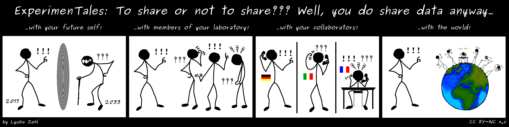

<small>Source: [ExperimenTales by Lyuba Zehl](https://gin.g-node.org/lzehl/ExperimenTales) (CC BY 4.0)</small>

::: {.notes}
So, so far we have talked about organizing and documenting your data for your future self and collaborators. But why should you care about making your data interoperable and reusable for others you don't know yet?

You might even contemplate not sharing your data at all. After all, sharing data takes time and effort, and you might worry about being scooped or misinterpreted.
But consider this: sharing your data can significantly increase the impact of your research. Studies show that papers with openly available data receive more citations. Sharing data also fosters collaboration, leading to new insights and opportunities you might not have anticipated.

Sharing data is not just about altruism; it's a strategic move that can enhance your scientific reputation and open doors to new funding and partnerships.

But, is your data ready to be readily reused by others?
:::

## The Hidden Work in Data Reuse {.center .smaller}

:::: {.columns}
::: {.column width="40%" .fragment .nonincremental}
#### You've made all these decisions:
- File organization strategy
- Naming conventions  
- Data formats
- Variable definitions
- Missing data codes
- Choice of hard metadata elements
:::
::: {.column width="60%"}
::: {.fragment}
#### Additionally, hopefully you've:
:::
::: {.fragment}
...written scripts for a reproducible workflow
:::

<br>

::: {.fragment} 
**But every researcher makes these same decisions independently**
:::

<br>

::: {.fragment}
**Even excellent data requires significant effort to understand and reuse**
:::
:::
::::
::: {.notes}
Think about this: you've spent considerable effort making all these organizational and formatting decisions for your data. You chose how to structure folders, what to call variables, which formats to use, how to handle missing data. These weren't arbitrary choices - you thought carefully about what worked for your research.

But here's the thing: every other researcher in your field is making these exact same decisions, independently, for their projects. They're solving the same problems you solved, but in their own way.

So when you want to reuse someone else's data - even beautifully organized, well-documented data - you still need to understand their decisions, learn their conventions, and often reformat things to match your workflow. The original researcher did excellent work, but you're essentially doing that organizational work all over again.

This is where community standards become powerful. Instead of everyone solving the same problems independently, standards let us share solutions and reduce everyone's effort.
:::
<!-- 
## Your FAIR Toolkit: Three Types of Standards {.center}

**Organizational Standards + Reporting Guidelines + Shared Vocabularies = Your FAIR toolkit**

::: {.fragment}
*The distinction between these is often blurry - most standards combine elements from all three*
:::

::: {.notes}
Your research community has likely developed three types of standards that work together to solve the data reuse problem. These aren't separate, competing approaches - they're complementary tools that address different aspects of making data truly usable.

The boundaries between these categories are intentionally fuzzy. Most established standards, like BIDS in neuroscience, combine organizational rules, reporting requirements, and vocabulary specifications all in one framework. That's actually their strength - they provide a complete system rather than piecemeal solutions.
::: -->

## Organizational Standards: Integrating Data to Your Analysis{.center .smaller}

:::: {.columns}
::: {.column width="40%"}
**The dream:** Download data, run your analysis script immediately

::: {.fragment}
*No manual adjustments, no data wrangling, no guesswork*
:::

::: {.fragment}
**The reality:** Spend hours figuring out folder structures and file naming
:::
:::

::: {.column width="60%" .fragment}
#### An organizational standard would provide:
- Standardized folder hierarchies
- Consistent file naming patterns  
- Predictable data locations

::: {.fragment}
such that we have...
:::

::: {.fragment}
...automated tools can navigate data
:::
:::
::::

::: {.notes}
You know that frustrating moment when you download a promising dataset, excited to test your analysis approach, only to spend the next three hours trying to figure out where the actual data files are buried and what cryptic naming scheme the researchers used?

Organizational standards solve this by creating predictable structures that both humans and software can navigate automatically. BIDS is a perfect example - it specifies exactly where different types of brain imaging files should live and how they should be named. The result? Analysis tools can automatically find and process data without manual intervention.

When everyone in neuroscience uses BIDS, your analysis pipeline that works on your data will also work on someone else's data, immediately. That's the power of shared organizational conventions.
:::

## Organizational Standards: BIDS Success Story {.center .smaller}


](images/dicom-reorganization.png){fig-align="center"}


::: {.notes}
BIDS is a great example of an organizational standard that has transformed data sharing in neuroscience. Before BIDS, sharing brain imaging data was a nightmare. Different labs had their own folder structures, file naming conventions, and metadata practices. This made it nearly impossible to reuse data without extensive manual reorganization. The data that came out of the scanner looked like something on the left, which made sense for the that specific equpiment but was not intuitive for reuse. On the right, you see how BIDS organizes the same data in a clear, consistent way.

And what this meant in practice is that researchers who adopted BIDS could share their data, and others could immediately use it with existing analysis tools. This dramatically lowered the barrier to data reuse, leading to more collaborative research and faster scientific progress.
BIDS didn't just standardize file organization; it created an ecosystem where tools, repositories, and researchers all spoke the same language. This is the kind of impact organizational standards can have when widely adopted.
:::

## Reporting Guidelines: What's Actually Essential? {.center .smallest}

:::: {.columns}

::: {.column width="50%"}
You have a brilliant idea about reusing existing data for a new analysis

<br>

::: {.fragment}
*You hope that the data provider recorded the sex of the participants, because you want to study sex differences in brain activity*
:::

<br>

::: {.fragment}
**The reality:** They only recorded the age, because that's what their analysis needed
:::
:::

::: {.column width="50%"}
::: {.fragment}
- Checklists of essential methodological details
- Standardized metadata elements
- Templates for documenting experiments
:::

::: {.fragment .smallest}
#### Some helpful resources:
- [EQUATOR Network](https://www.equator-network.org/) - reporting guidelines for medicine and health research
  - CONSORT (clinical trials)
  - STROBE (observational studies)
  - PRISMA (systematic reviews)
  - ARRIVE (animal research)
  - ..etc.
- [MIAME and MINSEQE](https://www.ncbi.nlm.nih.gov/geo/info/MIAME.html) - microarray and sequencing experiments
:::
:::

::::

::: {.notes}
This happens all the time. You find a dataset that looks perfect for your research question, but then realize the original researchers didn't record participant sex because it wasn't relevant to their study. Now your brilliant idea about sex differences is impossible to test.

This isn't anyone's fault - you can't predict every future research question. But reporting guidelines help solve this by telling you what information your field has learned is generally useful to collect, even if it's not central to your current analysis.

The EQUATOR Network is your go-to resource for finding established reporting guidelines which are listed by study type. CONSORT for clinical trials, STROBE for observational studies, PRISMA for systematic reviews, ARRIVE for animal research - these aren't arbitrary rules. They're checklists developed by researchers who've tried to replicate studies or reuse data and discovered what information is actually essential. For genomics work, MIAME and MINSEQE provide similar guidance for microarray and sequencing experiments.

These guidelines represent the collective experience of your field about what details matter for reproducibility and reuse. Use them as your safety net - they help ensure your data can answer not just today's questions, but tomorrow's questions too.
:::

## Communicating About Concepts {.center .smaller}

:::: {.columns}
::: {.column width="50%" .fragment}
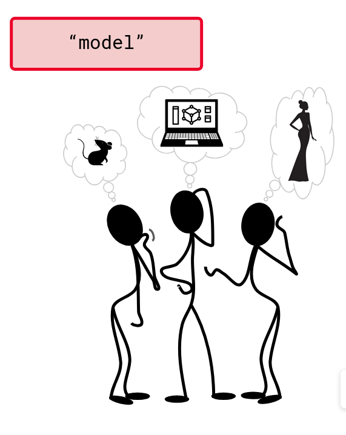{fig-align="center" width="80%"}
:::
::: {.column width="50%" .fragment}
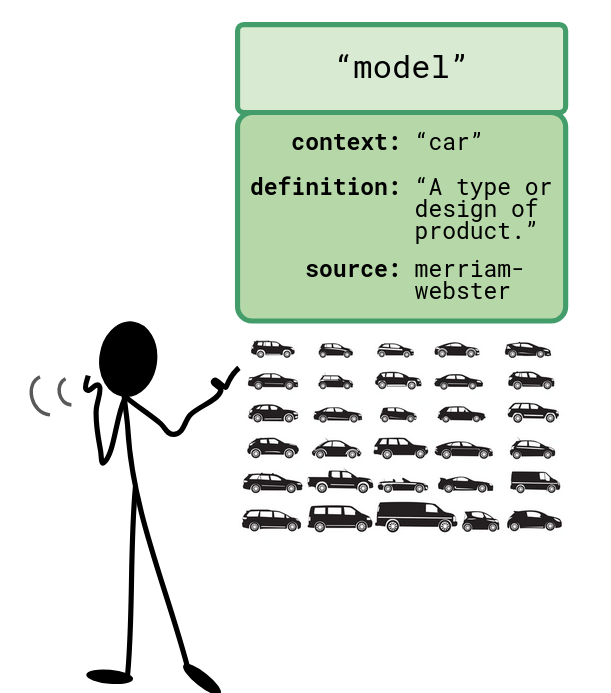{fig-align="center" width="80%"}
:::
::::

::: {.fragment}
<small>Source: Illustrations from EBRAINS School 2024 by Lyuba Zehl - used with permission</small>
:::

::: {.notes}
So, what do you think this cartoon here is illustrating?

[wait for audience responses]

It's the vocabulary problem in action. The word "model" is so overloaded with different meanings that without context, it's impossible to know what someone means. Are they talking about fashion models, mathematical models, or something else entirely?

But, with a clear context, the meaning becomes obvious. 
:::

## Shared Vocabularies: Communicating well {.center .smallest}

:::: {.columns}
::: {.column width="40%" .fragment}
#### You search for datasets with "statistical models" and get:
- Fashion models
- Airplane models  
- Mathematical models
- Animal models
- Conceptual models

::: {.fragment}
The word "model" is useless for finding what you actually need
:::
:::

::: {.column width="60%" .fragment}
#### A shared vocabulary would provide:
- Precise definitions: "linear regression model" vs "animal disease model"
- Standardized terms your field actually uses
- Machine-readable categories

::: {.fragment .smallest}
#### Some helpful resources:
- [Wikidata](https://www.wikidata.org/) - generic, multilingual vocabulary
- [NCBI BioPortal](https://bioportal.bioontology.org/) - comprehensive collection of biomedical ontologies
  - [NCBI Taxonomy](https://www.ncbi.nlm.nih.gov/taxonomy) - organisms
  - [Gene Ontology (GO)](http://geneontology.org/) - molecular biology
  - [MeSH terms](https://meshb.nlm.nih.gov/) - medical research
  - [ChEBI](https://www.ebi.ac.uk/chebi/) - chemical entities
:::
:::
::::

::: {.notes}
This is the vocabulary problem in action. You search for "model" and get everything from runway fashion to airplane prototypes.

Shared vocabularies solve this by providing precise, agreed-upon terms. Instead of "model," you'd search for "linear regression model" or "Alzheimer disease model mouse" - terms that have specific definitions your research community understands.

Wikidata works across disciplines as a multilingual knowledge base. NCBI BioPortal is your gateway to hundreds of biomedical ontologies - it's like a one-stop shop for finding the right vocabulary for your field. If you're working with organisms, NCBI Taxonomy gives you standardized species names. For chemical compounds, ChEBI provides precise molecular identifiers. 

The key insight: you don't need to create these vocabularies - they already exist. Gene Ontology has been developed by molecular biologists for decades. MeSH terms are used by every major medical database. EDAM covers bioinformatics tools and data types comprehensively.

This isn't just about better search results. When everyone uses the same controlled vocabulary, computers can automatically find related datasets, combine data appropriately, and enable meta-analyses that would be impossible otherwise. Your data becomes part of a network instead of an isolated file.
:::

## When No Standards Exist: Finding Your Field's Champions {.center .smallest}

::: {.fragment}
**No established standard in your niche?**
:::

:::: {.columns}
::: {.column width="60%"}
::: {.fragment}
#### Look for data sharing pioneers:
- Researchers who consistently share well-organized data
- Labs with detailed data documentation practices
- Early adopters of open science practices
- Active participants in data sharing initiatives
:::

::: {.fragment}
**Adopt and improve their approaches**
:::
:::

::: {.column width="40%"}
::: {.fragment}
#### These informal practices can become standards:
- Start small with your research group
- Share your solutions publicly
- Collaborate with other early adopters
- Eventually formalize into community standards
:::
:::
::::

::: {.notes}
Not every research area has fully developed standards yet, and that's okay. Your field might be too new, too interdisciplinary, or too specialized for formal standards to have emerged.

But I guarantee there are data sharing champions in your field - researchers who consistently publish well-organized, thoroughly documented datasets. They might not call themselves standards developers, but they're solving the same problems you are, and they're probably solving them thoughtfully.

Find these researchers. Look at how they organize their data, what they document, how they describe their methods. You don't have to reinvent every wheel - you can build on their solutions.

And here's the exciting part: when you adopt and refine these approaches, you're potentially contributing to the development of future standards for your field. Today's informal best practices become tomorrow's established standards. The researchers who developed BIDS started exactly this way - as individual labs sharing data in thoughtful ways, eventually realizing they could create something bigger together.

Your contribution to developing standards might be as simple as documenting and sharing your own data management approach. Sometimes that's all it takes to start a conversation that grows into community-wide adoption.
:::

## LMU-OSC Open Research Practice Guide {.center .smaller}

](images/practice-guide-ss.png)


## Activity: Build Your FAIR Toolkit {.smaller}

**Goal: Discover what your research community has already created**

5-Minute Toolkit Hunt with RDMKit

:::: {.columns}
::: {.column width="60%"}
::: {.incremental}
1. **Go to:** [rdmkit.elixir-europe.org](https://rdmkit.elixir-europe.org)
2. **Navigate to:** "Your Domain" section
3. **Find:** Your research area or closest match
4. **Note:** Organizational standards, reporting guidelines, vocabularies, and other solutions
5. **Backup:** If nothing fits, check "Your Tasks" section and choose what is most relevant to you
:::
:::

::: {.column width="40%"}
::: {.fragment}
#### Remember:
- This isn't about finding the *perfect* solution
- It's about discovering what already exists
- Even partial solutions count
- Take notes thinking about your own research data
:::
:::
::::

::: {.notes}
We're going to use RDMKit, which is specifically designed for researchers like you. It's organized by research domains and data types, making it much easier to find relevant standards than generic databases.

Start at rdmkit.elixir-europe.org and go to the "Your Domain" section. Find your field or the closest match - don't worry if it's not perfect. Look for what they recommend for data organization, reporting, and vocabularies. If your field isn't listed, try the "Your Tasks" section and browse by what's most relevant to your work.

This isn't about finding the one perfect standard that solves everything. It's about learning what exists and deciding what makes sense for your research. Whether you find field-specific standards or need to adapt general practices, you're building a foundation you can grow from.

After 10 minutes, we'll have people share what they discovered using the template on the next slide.
:::

## Your FAIR Toolkit Worksheet {.smaller}

<br>

**My research field/closest match:** _________________________________

**One thing I discovered that could help my data organization:** _________________________________  
*(Could be: field-specific standard, general practice, tool, or approach)*

**One resource for documenting my data:** _________________________________  
*(Could be: reporting guideline, metadata schema, journal template, or documentation approach)*

**One way to improve terminology consistency:** _________________________________  
*(Could be: controlled vocabulary, glossary creation, existing terminology, or team agreement)*

## Be FAIR and CARE {.center .smaller}

:::: {.columns}
::: {.column width="60%"}
](images/care-principles.png){width="42%"}
:::

::: {.column width="40%" }
- FAIR: "Can people access this data?"
- CARE: "Should they? How do communities benefit?"
- Essential for Indigenous data and community-centered research
:::
::::


::: {.notes}
Now that we've talked about community standards and adopting existing practices, it's important to address another framework that's increasingly essential in research data management: the CARE principles. While FAIR principles focus on making data technically accessible and reusable, CARE principles (Collective Benefit, Authority to Control, Responsibility, and Ethics) ensure that data use serves the communities it represents, especially Indigenous communities and other marginalized groups.

CARE principles are particularly crucial when working with Indigenous data, cultural heritage information, or any data that represents community knowledge. They emphasize that communities should have authority over how their data is collected, used, and shared. This isn't just about consent. It's about ongoing relationships, reciprocity, and ensuring that research benefits the communities involved, not just the researchers.

Think of CARE as the ethical complement to FAIR. Where FAIR asks "Can people access and use this data?", CARE asks "Should they?" and "How do we ensure the community benefits?" This is especially relevant as we move toward data sharing: it's not enough to make data technically accessible if we haven't considered the ethical implications and community impact.

For most of you, this might mean ensuring your consent processes include discussions about long-term data use, checking whether your research benefits the communities you study, and being mindful of power dynamics in data ownership. Even if you're not working directly with Indigenous communities, CARE principles offer valuable guidance for responsible, community-centered research practices.
:::


# Part V: Sharing Your Data with the World {.center background-color="#00883A"}

::: {.notes}
So, now your data is well organized, well documented, and follows community standards. The next step is to make sure it can actually be found and accessed by others. The very first step in making your data FAIR is ensuring it's findable. If no one can discover your dataset, all the effort you've put into organizing and documenting it is wasted.
:::

##  Licensing: Setting the Rules for Your Well-Organized Data

::: {.fragment}
#### You've done the hard work:
- Organized files systematically
- Created comprehensive metadata
- Documented everything clearly
:::

::: {.fragment}
Now the final step: How do you want others to use it?
:::

::: {.fragment}
Without a license → Others avoid your data (even with good intentions)
:::

::: {.notes}
You've invested time in organizing your data well, creating metadata, and making it research-ready. The last crucial step is defining how others can use this valuable resource. If no license is provided, other researchers can't tell what they're allowed to
do with your data and will often avoid using it entirely, defeating all your careful preparation.
:::

<!-- Skipping copyright and licensing details -->

## License Choice {.center}

:::: {.columns}
::: {.column width="60%"}
::: {.fragment fragment-index=1}
Many license options exist, but [Creative Commons](https://creativecommons.org) is the most widely used in research
:::

::: {.fragment fragment-index=2}
Rule of thumb: Choose the LEAST restrictive license
:::

::: {.fragment fragment-index=3}
**Why? Maximum reuse = Maximum impact**
:::
:::

::: {.column width="40%"}
::: {.fragment fragment-index=2}
[](https://creativecommons.org)
:::
:::
::::

::: {.notes}
There are several licenses out there, [Creative Commons](https://creativecommons.org), MIT, Apache, Open Data Commons, and ultimately it's your responsibility to pick one. If you don't want to read through all the options, Creative Commons licenses are usually a safe choice for research data. Remember this rule of thumb: go with the least restrictive license to maximize your data's reuse potential.
:::

## Two Ideal Choices {.center}

::: {.incremental}
- CC0 if your data isn't copyright protected (most measurement data)
- CC-BY if copyright exists (surveys, interviews, creative work)
:::

::: {.fragment}
CC BY - simply "cite me if you use my data" - the norm in science
:::

::: {.notes}
The recommendations are straightforward: use CC0 if your data isn't protected by copyright, which is often the case. Use CC-BY when copyright exists. Here's the key insight: CC-BY merely requires attribution. It's just formalizing good scientific practice. You're setting conditions that are self-evident to scientists, though it does create extra effort for reusers figuring out how to cite correctly.
:::

## Why Avoid More Restrictive Licenses? {.center}

::: {.fragment}
- Different restrictions = Can't combine datasets
- Blocks meta-analyses and follow-up research
- Creates legal headaches for everyone
:::

::: {.fragment}
CC BY solves this: global use, simple credit.
:::

::: {.notes}
Using more restrictive licenses should be carefully considered if you want your data reused. Here's why: it can become impossible to merge datasets published under different restrictive licenses because they're incompatible. This prevents follow-up research, archiving, and even publication of combined data. CC0 is great because it's universally compatible and ensures free reusability of research data.
:::

## Choosing a repository: Your Data's Home {.center}

::: {.fragment}
Your data is organized, licensed, and ready to share
:::

::: {.fragment}
But where does it live?
:::

::: {.fragment}
Not all repositories are created equal
:::

::: {.notes}
Your data is beautifully organized, you've chosen an appropriate license, and you're ready to share it with the world. But now comes a crucial decision: where should it live? This isn't just about finding any place to upload files. It's about choosing the
right home that matches your data's needs and your research goals.
:::

## Repository Choice: Match Your Needs {.center}

::: {.incremental}
- Field-specific visibility? → Disciplinary repositories (preferred option: [PsychArchives](https://www.psycharchives.org), [GIN](https://gin.g-node.org))
- Sensitive data + compliance? → Institutional repositories (Open Data LMU - personal consultation advantage) or trusted research environments (TREs)
- Active collaboration? → Platforms with version control ([GitLab (LRZ)](https://gitlab.lrz.de), [GitHub](https://github.com))
- Broad discoverability? → General repositories ([Zenodo](https://zenodo.org))
:::

::: {.notes}
Your repository choice should be strategic. The preferred option is disciplinary repositories where your research community will find you, for example PsychArchives for psychology or GIN for neuroscience, which is run by the German Neuroinformatics Node here at LMU. If you're dealing with sensitive data and need institutional support, your university repository might be best - consider seeking personal consultation as early as possible. For data too sensitive to deposit anywhere, trusted research environments are the emerging answer: the data never leaves a secure environment, and approved researchers come to the data instead of downloading it. If you're actively collaborating and need version control, platforms like GitLab or GitHub work well. As LMU researchers you already have free access to the GitLab instance run by the LRZ, which keeps unpublished work on Bavarian infrastructure. For maximum discoverability across all fields, a general repository like Zenodo is a great fallback. Let me show you re3data.org, where you can filter repositories by your subject area to find the right fit.
:::

## What Makes a Good Repository? {.center}

- Persistent identifiers (DOI assignment)
- Clear preservation policies (will it still exist in 10 years?)
- Good metadata support (helps with discoverability)
- Community trust (CoreTrustSeal certification is a good sign)

::: {.fragment}
**Also crucial: The location where your data is stored**
:::

::: {.fragment}
**When in doubt: [Zenodo](https://zenodo.org) is a solid default choice**
:::


::: {.notes}
Not all repositories are equally reliable. Look for key features: Do they assign DOIs? Do they have clear policies about long-term preservation? Do they support good metadata that helps people find your work? Community trust matters: CoreTrustSeal certification is a good indicator.

Another crucial factor is the physical location where your data is stored. For European researchers, GDPR compliance is mandatory, repositories storing data on EU servers provide legal certainty. Repositories outside the EU may require additional data processing agreements or limit what data you can share.

When you're unsure, Zenodo is a solid default choice backed by CERN with strong preservation commitments, broad academic acceptance, and EU-based servers ensuring GDPR compliance.
:::


## Find YOUR Repository Now {.center}

### 3-Minute Repository Hunt:

1. Go to: [re3data.org](https://re3data.org)
2. Type your research area in the search box
3. Browse top results, pay attention to "Country", "Subjects"
4. Make a search for "[Zenodo](https://zenodo.org)" if nothing field-specific appears

::: {.notes}
Let's spend 5 minutes finding your repository options. Go to re3data.org and filter by your subject area first. Look for the key features we just discussed: data upload allowed, DOI assignment, and ideally some certification.

Don't spend forever on this - check the top few results, read their scope quickly. Your goal is to identify one field-specific option if it exists, and have a general backup plan. Remember, Zenodo is always a reliable fallback that accepts any type of research data.

The perfect repository that nobody in your field uses is less valuable than the good repository that everyone knows about.
:::

## Find YOUR Repository Now Worksheet {.center}

::: {.fragment}
**My repository choices:**

1. **Field-specific option:** _________________________________

2. **General backup option:** _________________________________ 
*(Default: Zenodo if no field-specific option works)*
:::

## From Repository to Recognition: Persistent Identifiers {.center}

::: {.fragment}
You've chosen a repository and license
:::

::: {.fragment}
But how do you ensure people find your data and you get credit?
:::

::: {.fragment}
PIDs = Permanent addresses that never break
:::

::: {.notes}
You've organized your data, documented it well, chosen a license, and picked a repository. But here's the final piece: how do you make sure people can actually find your work and that you get proper credit? This is where Persistent Identifiers come in: they're permanent digital addresses that never break, solving the link broken, 404 or page moved problem we've all experienced.
:::

## The Four PIDs You Need to Know {.center .smaller}

::: {.incremental}
- DOI (Digital Object Identifier) → **What you created** (datasets, papers) - *assigned by repository automatically*
- ORCID (Open Researcher and Contributor ID) → **Who you are** (your researcher identity) - *you create and update profile* - [orcid.org](https://orcid.org)
- RRID (Research Resource Identifier) → **What you used** (materials, software) - *you look up existing identifiers* - [rrid.site](https://rrid.site/)
- ROR (Research Organization Registry) → **Where you work** (institution) - *institutional identifier, usually automatic* - [ror.org](https://ror.org)
:::

::: {.fragment}
Start simple: DOI + ORCID covers most needs
:::

::: {.notes}
Four PIDs cover your research identity infrastructure. DOI identifies what you created. This answers the metadata question "What do the data files contain?" ORCID answers "Who created the dataset?" and follows you across institutions. RRID answers "How was
the dataset generated?" by identifying specific materials. ROR identifies where the work happened. You don't need all four immediately: DOI for your data and ORCID for yourself covers most of what you need. This connects back to our proper metadata discussion. PIDs essentially formalize the key metadata questions in a standardized, machine-readable way. Instead of just writing "John Smith created this," you use an ORCID that uniquely identifies John Smith forever. Instead of a description that might be ambiguous, you have a DOI that points to the exact dataset. This is how we move from human-readable to machine-actionable metadata.
:::

## Data Availability Statement (DAS): Connecting All the Pieces {.center}

::: {.fragment}
You've organized, licensed, chosen a repository, and got PIDs
:::

::: {.fragment}
But when someone reads your paper, how do they find your data?
:::

::: {.fragment}
A clear "Data Availability Statement" (DAS) connects all the pieces
:::

::: {.notes}
Your data is organized, licensed, living in a repository with a DOI, and you have your ORCID. When someone reads your paper, how do they actually find your data? You need a clear "Data Availability Statement" that connects all these pieces together.
:::

## Data Availability Statement (DAS) Examples {.center .smaller}

:::: {.columns}
::: {.column width="50%"}
#### Ineffective Statements
- _"Data available upon request"_
- _"Contact corresponding author"_
- _"Data will be shared on reasonable request"_
:::
::: {.column width="50%" .fragment}
#### Effective Statements
- _"Data: https://doi.org/10.5281/zenodo.1234567 (CC0)"_
- _"Code: https://github.com/user/project (MIT)"_
- _"Materials: https://doi.org/10.xxxx/xxxxx (CC-BY)"_
:::
::::
::: {.fragment}
**Many journals now require specific DAS formats - check guidelines!**
:::

::: {.notes}
Avoid vague statements like "data available upon request". These create barriers to access and reuse. Instead, provide direct links to your datasets, code repositories, and materials with their DOIs and licenses. This makes it easy for readers to find and use your resources immediately.
:::

## Beyond DAS: Dataset Publications {.center .smaller}

:::: {.columns}
::: {.column width="60%"}
**Data Papers:** Publication of data along with a _"Data Descriptor"_ or _"Data Note"_ describing the dataset

::: {.incremental}
- Does not require novel findings
- Focuses on data quality and reuse potential
- Peer-reviewed and citable
- Specific journals: [Scientific Data](https://www.nature.com/sdata/), [GigaScience](https://academic.oup.com/gigascience), [F1000Research](https://f1000research.com)
:::

::: {.fragment}
**Making data a first-class research output!**
:::
:::

::: {.column width="40%"}
::: {.overlay-container style="position: relative; width: 100%; height: 500px;"}
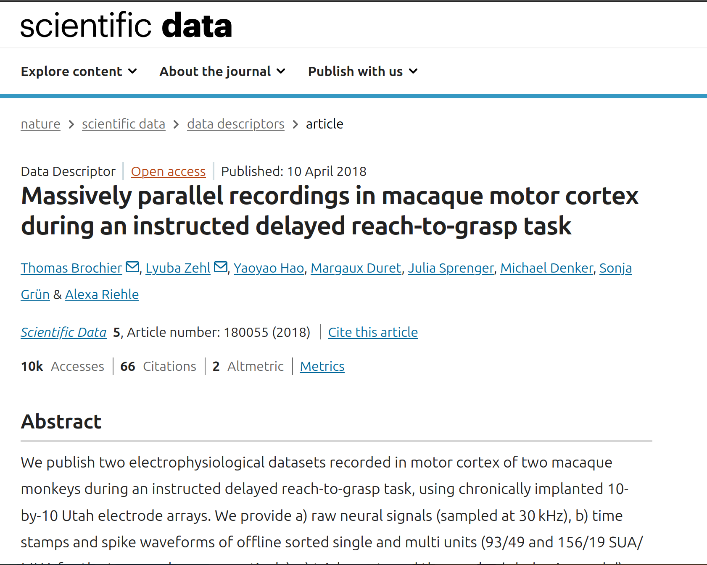{style="position: absolute; top: 0; left: 0; z-index: 1; width: 100%;"}
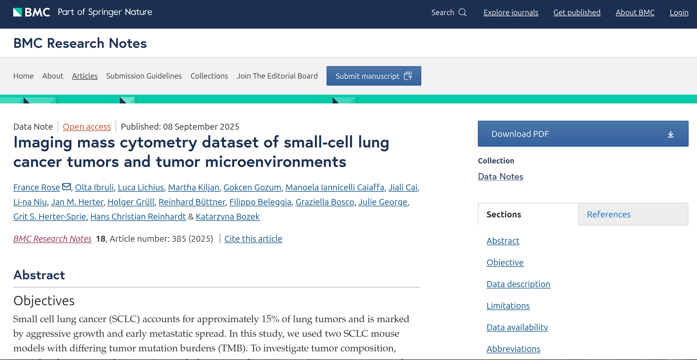{style="position: absolute; top: 220px; left: 60px; z-index: 2; width: 85%;"}
:::
:::
:::::

::: {.notes}
For datasets that are particularly valuable or complex, consider publishing a dataset paper. These publications focus on describing the dataset in detail, its collection methods, and potential reuse applications. They don't require novel findings but instead highlight the dataset's quality and utility. This approach elevates your data to a first-class research output, providing additional recognition and citation opportunities. This is also an opportunity to get publications as a PhD student or early career researcher, even if you don't have a lot of novel findings yet.
:::


# Wrap-Up: Your FAIR Data Journey {.center background-color="#00883A"}

## First Simple FAIR Checklist {.center .nonincremental .smaller}

::: {.columns .smaller }
::: {.column width="50%" .nonincremental}
#### Planning Phase (Findable + Reusable)
- [ ] Repository identified
- [ ] License selected (CC0/CC-BY)
- [ ] File naming conventions documented
- [ ] Folder structure planned
- [ ] Community standards identified

#### Active Research (Interoperable + Accessible)
- [ ] README maintained with context
- [ ] Data dictionary created
- [ ] Metadata captured systematically
- [ ] Open formats used when possible
- [ ] Raw data preserved separately
:::

::: {.column width="50%" .nonincremental}
#### Pre-Publication (All FAIR principles)
- [ ] Documentation complete and clear
- [ ] Formats standardized for sharing
- [ ] Data uploaded to repository
- [ ] Metadata finalized
- [ ] Access permissions set

#### Publication (Findable + Accessible)
- [ ] DOI assigned and verified
- [ ] ORCID profile updated
- [ ] Data Availability Statement (DAS) written
- [ ] All links functional
:::
:::

::: {.notes}
**Speaker Notes:**
Here's your tangible takeaway - a FAIR checklist organized by research phase and mapped to FAIR principles. Notice how license selection happens early in planning, not as an afterthought. Each phase builds toward different FAIR goals: Planning sets up findability and reusability, Active Research ensures interoperability and accessibility, Pre-Publication brings everything together, and Publication makes it all discoverable. Depending on your project stage, you can focus on the relevant section.
:::

## OPTIONAL Follow-Up {.center .smaller}

:::: {.columns}
::: {.column width="40%" .smallest .nonincremental}
**Self-guided FAIR evaluation tutorial**

Practice applying FAIR principles by evaluating real published datasets. You'll work through:

- **Publication** - Can you associate the dataset with its publication? Are the licenses clear?
- **Documentation** - Is the metadata sufficient for reuse? How about the README and data dictionary?
- **Organization** - Can you navigate and understand the data structure?

:::

::: {.column width="60%"}
](images/optional-follow-up-ss.png){width="90%"}
:::
::::

::: {.callout-tip .smallest}
#### Why do this?
This hands-on practice helps you recognize FAIR (and not-so-FAIR) data - making you a better data consumer and producer.
:::

## Your Commitment {.center}

Not "I'll try to be more FAIR" but something like:

- "I'll rename all files in my current project"
- "I'll create a README for my last dataset"
- "I'll upload my pilot data to Zenodo"
- "I'll document my variable names"

. . .

**My commitment:** _________________________________

::: {.fragment}
**Tell your neighbor - accountability helps**
:::


::: {.notes}
Before we wrap up, I want you to make one concrete commitment to yourself. Not a vague intention like "I'll try to be more FAIR," but a specific, achievable action you'll complete this month. Write it down right now.

Now I want you to share that commitment with someone near you.

Remember, this commitment isn't about achieving perfection or transforming everything overnight. It's about taking that crucial first step. Pick something you can realistically accomplish this month. 
:::


## Thank You! Questions? {.center}

## Acknowledgments {.center .smaller .nonincremental}

We gratefully acknowledge the inspiration, resources, and materials that made this workshop possible:

- **FAIR Research Data Management Tutorial** [@kleemeyerFAIRResearchData2025]
- **Research Data Management in Neuroscience**, course materials, LMU Munich [@wachtlerResearchDataManagement]
- **So, Why Go FAIR?** [@SoWhyGo2023]

## References

::: {#refs}
:::