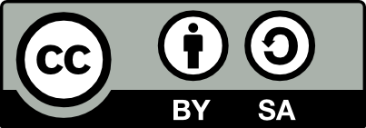

::: {.callout-warning collapse="false"}
## Copy this template - do not edit directly
*This is a template landing page with an example slide deck embedded within. Create your own folder and **copy** these materials (index file, slides qmd, images and assets folders) - do **not** edit the template directly. Get inspiration from other landing pages and completed slide decks. Delete this call-out box when the materials are final.*
:::

> Preregistration part I: introduction and how to guide

[Click here to see the materials in full screen](preregistration-part-I-slides.qmd)


```{=html}
<iframe class="slide-deck" src="preregistration-part-I-slides.html" height="420" width="747" style="border: 1px solid #2e3846;"></iframe>
```

## About these materials

::: {.callout-warning collapse="true"}
## Citation statement

Middleton, L. S. & Ihle, M. (2026). Preregistration part I: introduction and how to guide \[Quarto slides\]. [LMU Open Science Center](https://www.osc.lmu.de/) and [FORRT](https://forrt.org/). <https://lmu-osc.github.io/teaching-material-for-novices/open-research-principles/preregistration-part-I>
:::

**Welcome!** This workshop is intended to provide learners with an introduction to the context of why preregistration exists as an open science practice. The session first discusses key concepts and topics such as different research methodologies (e.g. qualitative, experimental, observational), confirmatory vs exploratory analysis, questionable research practices. The session then outlines the essential and recommended elements to include in a study preregistration, with resources to find templates by research method.

### Who are these materials for?

- **Educators** in higher education with or without familiarity with open research planning to **teach open research** to **novices**
- **Self-learners** with no or limited familiarity with open research planning to **develop and build** up on their open research skills

### Prerequisites

<div style="font-size: 0.8em;"> 
| Prerequisite   |  Description  | Where to find it   |
|------------|------------|------------|
| R and RStudio installed | Latest versions of both R and RStudio | [Download RStudio](https://posit.co/download/rstudio-desktop/) |
| Basic R skills | Introduction to R - Part I | [Access here](https://lmu-osc.github.io/teaching-material-for-novices/open-research-tools/r-part-I/) |
| Zotero | Reference Management Tool | [Download Link](https://www.zotero.org/) |
</div>


### Learning objectives:

This session aims to take learners from:


At the end of this session, you or your learners will be able to:

-   **Recognize** the context of why preregistration exists as an open
    science practice
-   **Identify** the key components of a study preregistration
-   **Describe** the differences between study preregistration and
    registered reports    
    
## Download materials

### Export slides

You can export these slides as MS PowerPoint (.pptx - *in progress*) or pdf by clicking below. Note that basic formatting will be applied to the PowerPoint file.

<!-- download as pdf button -->
<a href="preregistration-part-I-slides.pdf"
   download="preregistration-part-I-slides.pdf"
   class="btn btn-primary">
  Download slides as PDF
</a>

### Supplementary files

<div style="display: flex; gap: 1rem;">
  <a href="assets/example-quarto-cheatsheet.pdf"
     download="example-quarto-cheatsheet.pdf"
     class="btn btn-primary"
     style="flex: 1; text-align: center;">
    Download the example cheatsheet
  </a>
</div>

## Contributors and licence details

**Creator**: Middleton, Sara Lil ({fig-alt="orcid logo"} [0000-0001-5307-8029](https://orcid.org/0000-0001-5307-8029)) 

**Reviewer**: Ihle, Malika ({fig-alt="orcid logo"} [0000-0002-3242-5981](https://orcid.org/0000-0002-3242-5981))

<br>

<p style="text-align:center;">
  
</p>

::: {style="background-color: #f0f0f0; padding: 0.05em; border-radius: 2px; font-size: 0.6em;"}
This work by [Sara Lil Middleton](https://www.osc.lmu.de/people/people/sara-lil-middleton.html) and  [Malika Ihle](https://www.osc.lmu.de/people/people/malika-ihle.html) is licensed under a [Creative Commons Attribution 4.0 International SA License](https://creativecommons.org/licenses/by-sa/4.0/deed.en) (CC-BY-SA 4.0).
:::