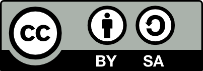

## Prerequisites

::: callout-important
Before completing this session, please carefully read about the
prerequisites.
:::

::: {style="font-size: 0.6em;"}
| Prerequisite | Description | Link/Where to find it |
|------------------------|------------------------|------------------------|
| Topic Name | Basic intro to X | [OSC Website Link](url) |
| Software Name | Configuring the environment | [Download Link](https://quarto.org) |
:::

::: footer
Add references in the footer.
:::

::: notes
**Presenter Notes**: These are the **presenter notes**. You will a
script for the presenter for every slide. In presentation mode, your
audience will not be able to see these presenter notes, they are only
visible to the presenter.

Add the script for this slide.

**Instructor Notes**: There are also **instructor notes**. For some
slides, there will be pedagogical tips, suggestons for acitivities and
troubleshooting tips for issues your audience might run into. You can
find these notes underneath the speaker notes.

These are the prerequisites for this topic. Before you get started on
this topic with your audience, you need to ensure that the audience
fulfills these criteria. Outline any essential prerequisites (software,
tools, other sessions etc.) here in table format. If you prefer bullet
points to list the prerequisites, delete the table and use bullet points
instead.

**Accessibility Tips**: Where applicable, this is a space to add any
tips you may have to facilitate the accessibility of your slides and
activities.
:::

------------------------------------------------------------------------

## Questions from the previous session

::: {style="background-color: #f0f0f0; padding: 0.1em; border-radius: 5px; font-size: 1em; text-align: center;"}
Are there any open questions regarding **Topic**?
:::

::: notes
**Presenter Notes**: Script for the slide here.

**Instructor Notes**: This first slide is dedicated to clarifying
questions from the previous session and/or to discuss assignments.

- Additional slides may need to be added depending on the nature of the
  homework assignments.
- Critical for the learning process to ensure that learners are on the
  same page and have been able to achieve the learning goals of the
  previous workshop.
- Not applicable if this set of slides corresponds to the first session
  of a new module.
:::

------------------------------------------------------------------------

## Before we start: Survey time!

::: panel-tabset
### Question 1

**What is your level of familiarity with \[Topic\] (e.g., basic
concepts, terminology, or tools)?**

a.  I have never heard of it before.

b.  I have heard of it but have never worked with it.

c.  I have basic understanding and experience with it.

d.  I am very familiar and have worked with it extensively.

### Question 2

**Which of the following concepts or skills do you feel most confident
about in relation to \[Topic\]? (Select all that apply)**

a.  Concept 1

b.  Concept 2

c.  Concept 3

d.  Concept 4

e.  I am not sure about any of these concepts.

### Question 3

**On a scale of 1 to 5, how comfortable are you with using \[specific
tool/technology\] related to \[Topic\]? (1 = Not comfortable at all, 5 =
Very comfortable)**

a.  1

b.  2

c.  3

d.  4

e.  5
:::

::: notes
**Presenter Notes**: Script for the slide here.

**Instructor Notes**: This survey serves to examine learners' prior
knowledge about the topic. For an interactive delivery, use free tools
such as for example [Particify](https://www.particify.de/en/) to create
interactive surveys with QR codes before you deliver this lesson. The
pre-session survey should serve to examine learners' prior knowledge
about version control and related concepts. Note that this survey cannot
be completed in an asynchronous setting because the survey results
cannot be displayed.
:::

------------------------------------------------------------------------

## Discussion of survey results

What do we see in the results?

::: notes
**Presenter Notes**: Let us have a look at these results.

**Instructor Notes**:

- **Aim**: Briefly examine the answers given to each question
  interactively with the group. Use visuals from the survey to highlight
  specific answers.

**Accessibility Tip**: Have people work in pairs if someone did not
bring their phone/does not have a phone. This survey also cannot be
completed in an asynchronous setting.
:::

------------------------------------------------------------------------

## Where are we at?

**Previously**:

- Point 1
- Point 2

**Up next**:

- Point 1
- Point 2

::: notes
**Presenter Notes**: Script for the slide here.

**Instructor Notes**:

- **Aim**: Place the topic of the current session within a broader
  context.
- Remind learners what you are working towards and what the bigger
  picture is.
:::

------------------------------------------------------------------------

## Learning goals

**Aim**: Examine study preregistration as an open science practice, its
links to addressing questionable research practices and what components
make up a preregistration. <br> <br>

There are **two** sections to this submodule:

- **Section 1**: Introduction to study preregistration

- **Section 2:** How to do a study preregistration

::: notes
**Presenter Notes**: This slides serves as an overview of the topics
that are discussed, presented as bullet points.
:::

------------------------------------------------------------------------

## Section 1: Learning goals and overview

Section 1 is all about learning the key terms and definitions and to get
you thinking about the *what* and the *why* of study registration. <br>
<br>

Activity: Reflection question and quiz <br> <br>

After completing section 1 you should be able to:

- **Recognize** the context of why registration exists as an open
  science practice

::: notes
*Speaker Notes:*

After completing section 1 you should be able to:

- **Recognize** the context of why registration exists as an open
  science practice

The main activity is a self reflection exercise
:::

------------------------------------------------------------------------

## Section 2: Learning goals and overview

Section 2 is all about learning about the steps involved in a study
preregistration <br> <br>

After completing section 2 you should be able to:

- **Identify** the key components of a study preregistration
- **Describe** the differences between study preregistration and
  registered reports

::: notes
*Speaker Notes:*

After completing section 2 you should be able to:

- **Identify** the key components of a study registration
- **Describe** the differences between study registration and registered
  reports
:::

------------------------------------------------------------------------

## Section 1: Introduction to preregistration

::: notes
*Speaker notes:*

Let's start get started with section 1 where will look at the context of
why study registrations exist.
:::

------------------------------------------------------------------------

## Warm up question to get us started!

In your research project, when do you typically *think about* the type
of *analysis* you use?

- [ ] A. As you collect your data
- [ ] B. After you have collected all your data
- [ ] C. As you plan your study

1.  *Reflect* on the question on your own
2.  We will *share* our answers in class

::: notes
*Speaker Notes:*

To get us to think about our current ways of working, I would like us
think about our current or past research project and reflect on this
question: In your research project, when do you typically think about
the type of analysis you use?

A. As you collect your data B. After you have collected all your data C.
As you plan your study

We will then share our some of our thoughts as a class.

*Instructor Notes:*

*Activity delivery mode:* Suitable for in person, online and hybrid
teaching formats: Provide learners with a minute to think and then
submit their answers anonymously on a pre-prepared Particify poll.
Project the results of the question on the board/share screen (if
online). Remark on the most popular answer and invite 1 or 2 learners to
share their experiences related to the question if they feel comfortable
sharing.

*Pedagogical add on:* This self reflection question invites learners to
reflect on their own workflows. It also primes them for the practice of
registration being about reframing or front loading research planning in
advance of collecting data.
:::

------------------------------------------------------------------------

## Section 2: How to do a study preregistration

::: notes
*Speaker Notes:*

In section 1 we covered the context and rationale of study
registrations, now in section 2 we will learn what the practical steps
involved are what information is needed to complete a study
registration.
:::

------------------------------------------------------------------------

## Study preregistration steps

There are a number of **essential** and a subset of **recommended**
elements to include in a preregistration [@stefan2023]:

1.  Hypotheses
2.  Design
3.  Planned sample
4.  Exclusion criteria
5.  Analysis plan

::: callout-tip
Think about the steps of doing a study registration like a recipe for a
cake! All the ingredients and methods should be clearly written so
another person can follow. If steps are unclear or missing the resulting
cake will look and taste different.
:::

::: notes
*Speaker Notes:*

There are five essential elements that go into a study registration
(hypotheses, design, planned sample, exclusion criteria and analysis
plan). These mirror some of the stages in the research life cycle we
have seen earlier. There are also additional recommendations that can be
added to registrations.

We will go through each element in turn.

It can be helpful to think about the steps involved in doing a study
registrations like a a recipe for a cake! All the ingredients and
methods should be clearly written so another person can follow. If steps
are unclear or missing the resulting cake will look and taste different.

*Instructor Notes:*

Sharing analogies like study registrations as following a cake recipe
can be helpful for learners to relate to seemingly abstract concepts in
a more familiar way.

It is advisable to share with learners, the steps outlined over the next
couple slides are more focused for hypothesis-testing research. Study
registrations for hypothesis-generating or exploratory research, exist
(e.g. see also Dirnagl (2020))

Dirnagl, U. (2020) Preregistration of exploratory research: Learning
from the golden age of discovery. PLoS Biol 18(3): e3000690.
https://doi.org/10.1371/journal.pbio.3000690
:::

------------------------------------------------------------------------

## Part 1: Hypotheses

[Essential:]{style="background-color: #30a347; color: #fcfcfd; padding: 3px 6px; border-radius: 4px;"}

  - *State* your research questions clearly
  - *Describe* the (numbered) hypotheses in the context of your
    variables
  - For interaction effects, *describe* the expected shape of the
    interactions.
  - If you are manipulating a variable, *make predictions* for
    successful check variables or explain why no manipulation check is
    included.

[Recommendations:]{style="background-color: #2b66ff; color: #FAF9F6; padding: 3px 6px; border-radius: 4px;"}

- Adding a table/figure to describe complex interaction
- For studies testing hypotheses, link stated hypotheses to theoretical
  frameworks


::: notes
*Speaker Notes:*

Essential things to include when stating hypotheses: a clearly stated
research question from which the hypotheses are linked and described in
detail.

For interaction effects, *describe* the expected shape of the
interactions. If you are manipulating a variable, *make predictions* for
successful check variables or explain why no manipulation check is
included.
:::

------------------------------------------------------------------------

## Part 2: Design

[Essential:]{style="background-color: #30a347; color: #fcfcfd; padding: 3px 6px; border-radius: 4px;"}

  - *List* of variables based on your hypotheses:
  - Independent variables (including levels, within or between
    participants, relationship between them (e.g. nested))
  - dependent variables or variables in a correlational design
  - third variables (e.g. covariates, moderators, control variables)

::: notes
*Speaker Notes:*

An essential element to document for study designs: Is clearly listing
variables based on your hypotheses, which include:

\- Independent variables (including levels, within or between
participants, relationship between them (e.g. nested))

\- dependent variables or variables in a correlational design

\- third variables (e.g. covariates, moderators, control variables)
:::

------------------------------------------------------------------------

## Part 3: Planned sample

[Essential:]{style="background-color: #30a347; color: #fcfcfd; padding: 3px 6px; border-radius: 4px;"}

  - If applicable, *state* any pre-selection rules (e.g. age limits)
  - *Indicate* where, from whom and how the data will be collected
  - *Justify* planned sample size (e.g. power analysis)
  - *Describe* data collection termination rule

::: notes
*Speaker Notes:*

When documenting planned sampling protocols any pre-selection rules
(e.g. age limits) should be stated, if applicable. Information (where?,
how? and who?) about data collection methods.

The planned sample size needs to be justified and the data collection
termination rule described.
:::

------------------------------------------------------------------------

## Part 4: Exclusion criteria

[Essential:]{style="background-color: #30a347; color: #fcfcfd; padding: 3px 6px; border-radius: 4px;"}

  - *Describe* anticipated specific data exclusion criteria such as:
  - missing, erroneous, or overly consistent responses
  - failing check-tests or suspicion probes
  - demographic exclusions
  - data-based outlier criteria (e.g expected variable ranges)
  - method-based outlier criteria (e.g. too short or long response
    times)
    
[Recommendations:]{style="background-color: #2b66ff; color: #FAF9F6; padding: 3px 6px; border-radius: 4px;"}

  - *Set* fail-safe levels of exclusion at which the whole study needs
    to be stopped, altered, and restarted.

::: notes
*Speaker Notes:*

When it comes to exclusion criteria, the following should be described:
how will you deal with missing, erroneous, or overly consistent
responses?

More pertinent for human-centered data collection, is how failing
check-tests or suspicion probes and how demographic exclusions will be
dealt with.

Outlier criteria related to data (e.g. state reasonable range of a
variable like an age of 140 would be excluded) and methods (e.g.too
short or long response times)

A recommendation is to set fail-safe levels of exclusion at which the
whole study needs to be stopped, altered, and restarted.
:::

------------------------------------------------------------------------

## Part 5: Analysis plan

[Essential:]{style="background-color: #30a347; color: #fcfcfd; padding: 3px 6px; border-radius: 4px;"}

  - *Describe* the analyses that will test each main prediction from the
    hypotheses section. For each one, include:
  - relevant variables and how they are calculated
  - statistical technique
  - each variable’s role in the technique (e.g., independent variable,
    dependent variable and covariates)
  - rationale for each covariate used, if any
  - if using techniques other than null hypothesis testing (e.g.
    Bayesian statistics), describe your criteria calculation of prior
    values or distributions

::: notes
*Speaker Notes:*

In an analysis plan, it is essential to include descriptions of the
analyses that will be done and how they relate to the predictions
outlined in the hypothesis section. The statistical techniques need to
be described and how each variable is calculated and how each variable
(independent, dependent and covariate) relates to the statistical
approach outlined. If covariate are included, their rational should be
stated.

In the case where Bayesian statistics are used, calculation of prior
values or distributions should be outlined.

*Instructor Notes:*

Instructors can pause at the end of this slide and remind students to
recall the reflection question at the beginning - when do you think
about what data analysis you will do? By bridging the prior activity
with this analysis plan checklist for a study registration it can help
learners reflect and identify their own knowledge gaps.

Instructors can ask learners to do a show of hands to the question of
would you change your answer going forward? (i.e. if their answers have
changed based on learning about analysis plans?).
:::

------------------------------------------------------------------------

## Part 5: Analysis plan continued

[Recommendations:]{style="background-color: #2b66ff; color: #FAF9F6; padding: 3px 6px; border-radius: 4px;"}

  - *Specify* contingencies and assumptions (e.g. method of correcting
    for multiple testing, missing data handling, data transformations,
    assumptions and assumption checks for analyses and alternative plans
    for data analysis if assumptions are not met).

::: notes
*Speaker Notes:*

If possible it is recommended that you specify contingencies and
assumptions such as missing data and data transformations (e.g.
Shapiro-Wilk's test for normal/Gaussian distribution)
:::

------------------------------------------------------------------------

## Additional considerations

Additional things to keep in mind as you plan your study.

Determine if you need to:

- plan for multi-stage contingent experiments
- anonymize your registration (e.g. place under embargo)
- apply for ethical approval

::: notes
*Speaker Notes:*

Other things that are important to consider whilst putting together a
study registration is whether your study requires anonymization (e.g.
place under embargo) or if ethical approval is needed.
:::

------------------------------------------------------------------------


------------------------------------------------------------------------


## Key terms and definitions

- **Key Term 1**
- **Key Term 2**
- **Key Term 3**

::: notes
**Presenter Notes**: These are key terms we will revisit throughout the
lesson. What comes to mind when you see each of them? Which ones are
familiar, and which feel new? Take a moment to think about what they
might mean.

**Instructor Notes**: Base yourself on conceptual change theory and
examine existing concepts in relation to some key terms. Re-examine the
formation of new concepts at the end of the lesson. Use a
think-pair-share approach. First, have learners reflect individually on
their associations with each term for a few minutes, then discuss in
pairs for a few minutes, and finally share with the group. Allow about
10 minutes for this activity.
:::

------------------------------------------------------------------------

## Key terms and definitions

- **Key Term 1**: Definition
- **Key Term 2**: Definition
- **Key Term 3**: Definition

::: notes
**Presenter Notes**: Let’s go through what these key terms mean:

**Instructor Notes**: Come back to this slide at the end of the lesson,
no need to go through in detail at this point. Learners just need to
know that this overview exists.
:::

------------------------------------------------------------------------

## Introduction to topic

::: notes
**Presenter Notes**: Add script for the slide here.

**Instructor Notes**:

- **Aim**: Core theoretical introduction of the topic.

- For a 90-minute lesson, the instructor should try to "lecture" for
  only 20 minutes, learners should work in groups/pairs/on their own for
  at least 55 minutes of the lesson (+ a 15 minute break).

- Pair theoretical aspects with practical exercises and group
  discussions according to the Think-Pair-Share style and according to
  Cognitive Load Theory (Sweller, 1980).

- Use multiple slides for this part.
:::

------------------------------------------------------------------------

## Topic content slide

::: callout-important
## Important with Title

This is an example of a callout box to highlight particularly important
information.
:::

::: callout-tip
## Tip with Title

This is an example of a callout box to give important tips.
:::

::: notes
**Presenter Notes**: Script for the slide here.

**Instructor Notes**: **Aim**: Present relevant content - Highlight
particularly important aspects with Quarto call-out boxes, for example:
:::

------------------------------------------------------------------------

## Practical exercise

**Task Name**

- [x] Step 1
- [ ] Step 2
- [ ] Step 3

::: notes
**Presenter Notes**: Script for the slide here.

**Instructor Notes**:

- **Aim**: Design more practical exercises for learners to apply the new
  skills in practice.

- Depending on the topic, the exercises should be in accordance with the
  learning objective(s).

- Add a description of the task, as well as a checklist as an overview
  of that your learners need to be doing.
:::

------------------------------------------------------------------------

## Recap

::: notes
**Presenter Notes**: Script for the slide here.

**Instructor Notes**: A summary with the most important achievements and
concepts up until now. This serves to consolidate and integrate new
concepts.
:::

------------------------------------------------------------------------

## Pre-break quiz

::: panel-tabset
### Question 1

**Which species is the largest type of penguin**?

a.  Chinstrap Penguin

b.  Emperor Penguin ✅

c.  Adélie Penguin

d.  King Penguin

### Question 2

**What is the key biological feature that helps penguins swim
efficiently?**

a.  Hollow bones for buoyancy

b.  Webbed feet for paddling

c.  Waterproof feathers and flipper-like wings ✅

d.  Gills to breathe underwater
:::

::: notes
**Presenter Notes**: Interactive quiz to check understanding and
retention of learners. Use free survey software such as
[Particify](https://www.particify.de/en/) to establish the following
questions (shown on separate slides).

**Instructor Notes**: This pre-break survey serves to examine learners'
current understanding of key concepts of the session. Guidance on
interpreting the results:

- If more than 80% of the learners select the correct response option,
  show which one it is and move on.

- If less than 80% of answers are correct, let them discuss with each
  other for 1-2 minutes which one they selected, and why, and afterwards
  let them re-take the question. If they\`re above 80% correct the
  second time, move on, else show the correct response and explain why
  it is correct (plus maybe why the others are not).

- If more than 30% select a specific distractor answer, discuss it in
  class.
:::

------------------------------------------------------------------------

## Post-break survey discussion

<br>

::: {style="background-color: #f0f0f0; padding: 0.1em; border-radius: 5px; font-size: 1em; text-align: center;"}
What do we see in the results?
:::

::: notes
**Presenter Notes**: Script for the slide here.

**Instructor Notes**:

- **Aim**: To clarify concepts and aspects that are not yet understood

- Highlight specific answers given during the survey
:::

------------------------------------------------------------------------

## Topic content slide

::: notes
**Presenter Notes**: Script for the slide here.

**Instructor Notes**:
:::

------------------------------------------------------------------------

## Practical exercise

**Task Aim**

- [x] Step 1
- [ ] Step 2
- [ ] Step 3

::: notes
**Presenter Notes**: Script for the slide here.

**Instructor Notes**:

- **Aim**: Design more practical exercises for learners to apply the new
  skills in practice.

- Depending on the topic, the exercises should be in accordance with the
  learning objective(s).

- Add a description of the task, as well as a checklist as an overview
  of that your learners need to be doing.
:::

------------------------------------------------------------------------

## Relevance and implications (if applicable)

- **Aim**: To work out the relevance of the topic to your learners.
- In an interactive setting, discuss how the new skills could be applied
  in practise with specific examples.
- Examine downfalls and practical obstacles.

::: notes
**Presenter Notes**: Script for the slide here.

**Instructor Notes**:

- **Aim**: To work out the relevance of the topic to your learners.

- In an interactive setting, discuss how the new skills could be applied
  in practise with specific examples.

- Examine downfalls and practical obstacles.
:::

------------------------------------------------------------------------

## Assignment

- **Aim**: Explain the homework assignment and the rationale behind the
  homework.
- Examine whether/how it will be assessed
- Mention scoring rubrics, if applicable
- Design a peer-review system for assignments to place learners in role
  of reviewer and author

::: notes
**Presenter Notes**: Script for the presentation here.

**Instructor Notes**:

- **Aim**: Explain the homework assignment and the rationale behind the
  homework.

- Examine whether/how it will be assessed

- Mention scoring rubrics, if applicable

- Design a peer-review system for assignments to place learners in role
  of reviewer and author
:::

------------------------------------------------------------------------

## Take-home message(s)

::: incremental
- Take-home message 1
- Take-home message 2
:::

<br> <br>

::: callout-tip
## Tip with Title

Add one practical tip in this box.
:::

::: notes
**Presenter Notes**: Script for the slide here.

**Instructor Notes**:

- **Aim**: End lesson on clear take-home message that are interactively
  compiled by learners.
:::

------------------------------------------------------------------------

## Recap: What have we done so far?

::: notes
**Presenter Notes**: Script for the slide here.

**Instructor Notes**:

- **Aim**: Provide overview of the topics covered today and remind
  learners of the bigger picture.
:::

------------------------------------------------------------------------

## Learning objectives: Check-In

**Where are we at?**

::: incremental
- [ ] **Explain** the importance ...
- [ ] **Familiarize yourself** with different ...
:::

::: notes
**Presenter Notes**: Let us pause for a quick check-in. Take a moment to
look back at the learning objectives and reflect on how comfortable you
feel with each one.

If you notice any gaps, this is the right moment to bring them up. Feel
free to ask questions or start a discussion so we can address them
before moving on.

**Instructor Notes**: Use this slide to encourage self-reflection rather
than evaluation. Emphasize that learners are not expected to feel
equally confident about all objectives at this stage. Keep the
discussion supportive and brief, focusing on clarifying concepts rather
than introducing new material.
:::

------------------------------------------------------------------------

## To conclude: Survey time!

::: panel-tabset
### Question 1

**What is your level of familiarity with \[Topic\] (e.g., basic
concepts, terminology, or tools)?**

a.  I have never heard of it before.

b.  I have heard of it but have never worked with it.

c.  I have basic understanding and experience with it.

d.  I am very familiar and have worked with it extensively.

### Question 2

**Which of the following concepts or skills do you feel most confident
about in relation to \[Topic\]? (Select all that apply)**

a.  Concept 1

b.  Concept 2

c.  Concept 3

d.  Concept 4

e.  I am not sure about any of these concepts.

### Question 3

**On a scale of 1 to 5, how comfortable are you with using \[specific
tool/technology\] related to \[Topic\]? (1 = Not comfortable at all, 5 =
Very comfortable)**

a.  1

b.  2

c.  3

d.  4

e.  5
:::

::: notes
**Presenter Notes**: Script for the slide here.

**Instructor Notes**:

- **Aim**: This post-session survey serves to examine learners' current
  knowledge about the sumodule's topic.

- Use free survey software such as particify or formR to establish the
  following questions (shown on separate slides)

- Use identical questions as in the pre-session survey to be able to
  directly compare
:::

------------------------------------------------------------------------

## Discussion of survey results

<br>

::: {style="background-color: #f0f0f0; padding: 0.1em; border-radius: 5px; font-size: 1em; text-align: center;"}
What do we see in the results?
:::

::: notes
**Presenter Notes**: Script for the slide here.

**Instructer Notes**:

- **Aim**: Briefly examine the answers given to each question
  interactively with the group.

- Compare and highlight specific differences in answers between pre- and
  post-survey answers
:::

------------------------------------------------------------------------

## References

::: {#refs}
:::

::: notes
**Presenter Notes**: Script for the slide here.

**Instructor Notes**: Highlight particularly relevant reading for your
learners in bold.
:::

------------------------------------------------------------------------

## Additional resources

- Videos
- Useful resources

------------------------------------------------------------------------

## Contribution statement

**Creator**: Von Grebmer Zu Wolfsthurn, Sarah
({fig-alt="orcid logo"}
[0000-0002-6413-3895](https://orcid.org/0000-0002-6413-3895))

**Reviewer**: Ihle, Malika
({fig-alt="orcid logo"}
[0000-0002-3242-5981](https://orcid.org/0000-0002-3242-5981))

**Consultant**: Schönbrodt, Felix
({fig-alt="orcid logo"}[0000-0002-8282-3910](https://orcid.org/0000-0002-8282-3910))

------------------------------------------------------------------------

## Licence and citation statement

<br>

<p style="text-align:center;">



</p>

::: {style="background-color: #f0f0f0; padding: 0.05em; border-radius: 2px; font-size: 0.6em;"}
This work was originally created by [FirstName Name](Staff%20URL) under
a CC-BY-SA 4.0 [Creative Commons Attribution 4.0 SA International
License](https://creativecommons.org/licenses/by-sa/4.0/deed.en). It was
subsequently adapted by [FirstName Name](url). This current work by
FirstName Name and FirstName Name is licensed under a CC-BY-SA 4.0
[Creative Commons Attribution 4.0 International SA
License](https://creativecommons.org/licenses/by-sa/4.0/deed.en). Code
snippets are dedicated to the public domain and are licensed under a
[Creative Commons Universal
License](https://creativecommons.org/publicdomain/zero/1.0/) (CC0 1.0).

Please cite these materials as: Name, S., Name, M., & Name, F. (2026).
*Slidedeck Title* \[Quarto slides\]. [LMU Open Science
Center](https://www.osc.lmu.de/).
<https://lmu-osc.github.io/teaching-material-for-novices/open-research-tools/topic>
:::

::: notes
**Presenter Notes**: The [Creative Commons Attribution 4.0 International
SA License](https://creativecommons.org/licenses/by-sa/4.0/deed.en), or
CC BY-SA 4.0, allows others to copy, share, and adapt a work in any
medium, including for commercial purposes. These permissions are broad
and cannot be withdrawn as long as the license terms are followed. The
main requirement is attribution: users must give appropriate credit to
the original creator, provide a link to the license, and clearly
indicate whether any changes were made, without implying endorsement by
the original author. In addition, the ShareAlike condition means that if
someone modifies or builds upon the work, the resulting material must be
distributed under the same CC BY-SA 4.0 license, or a compatible one.
Finally, users are not allowed to apply legal or technical restrictions,
such as DRM, that would prevent others from exercising these same
rights.

Code snippets are dedicated to the public domain and licensed under a
CC0 1.0 [Creative Commons Universal
License](https://creativecommons.org/publicdomain/zero/1.0/). You may
use, modify, distribute, and sell the code snippets for any purpose,
without permission or attribution. The code snippets are provided “as
is”, without warranty of any kind.
:::

------------------------------------------------------------------------

# End of slide deck

------------------------------------------------------------------------

# Formatting elements for instructors - delete

- **Aim**: This section contains templates for different formatting
  elements, which can be modified and adapted for the instructor's
  individual purposes. Delete when the slides are final.

------------------------------------------------------------------------

## Text with example links

- [Quarto Documentation](https://quarto.org/docs/)
- [Reveal.js Documentation](https://revealjs.com/)
- [Markdown Guide](https://www.markdownguide.org/)
- [GitHub](https://github.com/)

------------------------------------------------------------------------

## Basic text formatting

- **Bold:** `**bold**` → **bold**

- *Italic:* `*italic*` → *italic*

- ~~Strikethrough:~~ `~~text~~` → ~~text~~

- `Inline code:` `` `code` `` → `code`

- 

  > Blockquote: `> Quote` →\
  > "This is a quote"

------------------------------------------------------------------------

## Text with references

- Sample text for adding a reference in brackets
  [@abele-brehmWerSollProfessur2016]. **Use square brackets in the qmd
  file.**

- Sample text for adding in text-citation:
  @abele-brehmWerSollProfessur2016 argue that climate change is
  accelerating. **No brackets used in the qmd file.**

------------------------------------------------------------------------

## Call-out boxes

::: callout-caution
Include text here.
:::

::: callout-warning
Include text here.
:::

::: callout-tip
Include text here.
:::

::: callout-note
Include text here.
:::

------------------------------------------------------------------------

## Figure (centered) with caption and alt text

{width="80%"
fig-align="center" fig-alt="A penguin standing on ice"}

::: notes
**Note for pptx template**: Images are usually centered by default in
PPTX output. However, the font size and the image size must be
controlled in the PowerPoint template, not in Markdown. The text in
quotes represents the alt text that is visible when hovering over the
image in the slides. The alt text does *not* appear in the pptx and has
to be added manually in PowerPoint.
:::

------------------------------------------------------------------------

## Figure with bullet points

::::: columns
::: {.column width="50%"}
{width="80%" fig-align="center"
fig-alt="A penguin standing on ice"}
:::

::: {.column width="50%"}
- First bullet point
- Second bullet point
- Third bullet point
:::
:::::

------------------------------------------------------------------------

## Side-by-side figures

::::: columns
::: {.column width="70%"}
{width="100%" fig-align="center"
fig-alt="A penguin standing on ice"}
:::

::: {.column width="30%"}
{width="100%" fig-align="center"
fig-alt="A seal lying on ice and rocks on its side"}
:::
:::::

------------------------------------------------------------------------

## Stacked figures with text

::::: columns
::: {.column width="30%"}
{width="100%" fig-align="center"
fig-alt="A penguin standing on ice"}

{width="100%" fig-align="center"
fig-alt="A seal lying on ice and rocks on its side"}
:::

::: {.column width="70%"}
- First bullet point
- Second bullet point
- Third bullet point
:::
:::::

::: notes
**Note for pptx template**: Stacked figures cannot be resized in
markdown but need to be resized afterwards in pptx directly.
:::

------------------------------------------------------------------------

## Two-column text slide

::::: columns
::: {.column width="50%"}
**Column 1**

Lorem ipsum dolor sit amet, consectetur adipiscing elit.\
Vivamus lacinia odio vitae vestibulum vestibulum.\
Cras venenatis euismod malesuada.
:::

::: {.column width="50%"}
**Column 2**

Sed do eiusmod tempor incididunt ut labore et dolore magna aliqua.\
Ut enim ad minim veniam, quis nostrud exercitation ullamco laboris.
:::
:::::

------------------------------------------------------------------------

## Three-column text slide

:::::: columns
::: {.column width="33%"}
**Column 1**

Lorem ipsum dolor sit amet, consectetur adipiscing elit.\
Vivamus lacinia odio vitae vestibulum vestibulum.
:::

::: {.column width="33%"}
**Column 2**

Sed do eiusmod tempor incididunt ut labore et dolore magna aliqua.\
Ut enim ad minim veniam, quis nostrud exercitation ullamco laboris.
:::

::: {.column width="33%"}
**Column 3**

Duis aute irure dolor in reprehenderit in voluptate velit esse cillum
dolore eu fugiat nulla pariatur.
:::
::::::

------------------------------------------------------------------------

## Simple table

| Column 1   | Column 2   | Column 3   |
|------------|------------|------------|
| Row 1 Cell | Row 1 Cell | Row 1 Cell |
| Row 2 Cell | Row 2 Cell | Row 2 Cell |
| Row 3 Cell | Row 3 Cell | Row 3 Cell |
| Row 4 Cell | Row 4 Cell | Row 4 Cell |

------------------------------------------------------------------------

## Complex Table

| **Category** | **Metric**     | **Q1** | **Q2** | **Q3** | **Q4** |
|--------------|----------------|-------:|-------:|-------:|-------:|
| **Sales**    | Revenue        | 12,000 | 14,500 | 15,200 | 16,800 |
|              | Units Sold     |  1,200 |  1,450 |  1,520 |  1,680 |
| **Costs**    | COGS           |  5,000 |  5,200 |  5,400 |  5,600 |
|              | Operating Exp. |  2,300 |  2,400 |  2,450 |  2,500 |
| **Profit**   | Gross Profit   |  7,000 |  9,300 |  9,800 | 11,200 |
|              | Net Profit     |  4,700 |  6,500 |  7,000 |  8,100 |

> Note: Values are in USD thousands.

::: notes
**Notes for the pptx template**: Font size, padding or row and colour
number cannot be coded in markdown and have to be changed manually in
the pptx output.
:::

------------------------------------------------------------------------

## Task list

- [ ] Collect data
- [ ] Evaluate results
- ✅ Done (for PowerPoint conversion)-
- ⬜ To do pptx friendly

::: small
- [ ] Task one
- [ ] Task two
:::

::: notes
**Note**: This slide converts to pptx, but will not be interactive with
adding or eliminating a tick mark. This will convert into simple bullet
points.
:::

------------------------------------------------------------------------

## Linking to video with thumbnail

[](https://www.youtube.com/watch?v=q3uXXh1sHcI)

------------------------------------------------------------------------

## Code blocks

```{r}
# A basic R code chunk
x <- 1:10
mean(x)

# A simple plot
hist(rnorm(100), main = "Histogram of Random Normals")
```

::: notes
**Note**: PowerPoint *cannot run R code*, therefore the code block this
will appear as *formatted code text*, not executed output.
:::

------------------------------------------------------------------------

## Features supported in html but **not in pptx**

Here is an overview of which features **cannot** be transferred to a
pptx file from Quarto revealjs file (not exhaustive list):

- Custom HTML/CSS layout
  - Absolute positioning (position: absolute)
  - Flexbox / Grid layout
  - Custom margins, padding, alignment

------------------------------------------------------------------------

## Features supported in html **but not in pptx**

(continued)

- Fragments / incremental reveal
  - Click-to-reveal bullets or elements (.fragment)
  - Animations & transitions
  - CSS animations (@keyframes)
  - Reveal.js slide transitions (fade, zoom, etc.)

------------------------------------------------------------------------

## Features supported in html but **not in pptx**

(continued)

- Interactive JavaScript components
  - Plotly, Shiny apps, interactive charts
  - Custom JS widgets
  - Embedded iframes and external content
  - YouTube embeds
  - Google Maps
  - Embedded websites

------------------------------------------------------------------------

## Features supported in html but **not in pptx**

(continued)

- Dynamic sizing / responsive behavior

  - Percent-based sizing (width: 50%)

- Text shadows, letter spacing

- Custom tables with HTML styling

- Colored headers or rows

- Cell borders and padding via CSS

- Overlapping or rotated elements

------------------------------------------------------------------------

## Features supported in html but **not in pptx**

(continued)

- Rotated images or text

- Speech bubbles and callout shapes

- Bubble-style layouts

- Decorative shapes using CSS

- Embedded fonts and icon libraries

- Interactive quizzes or logic
