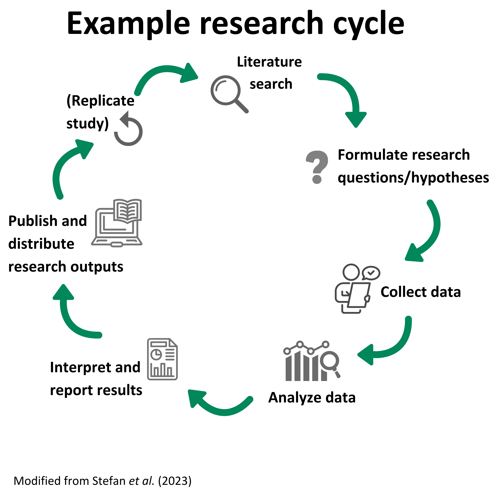
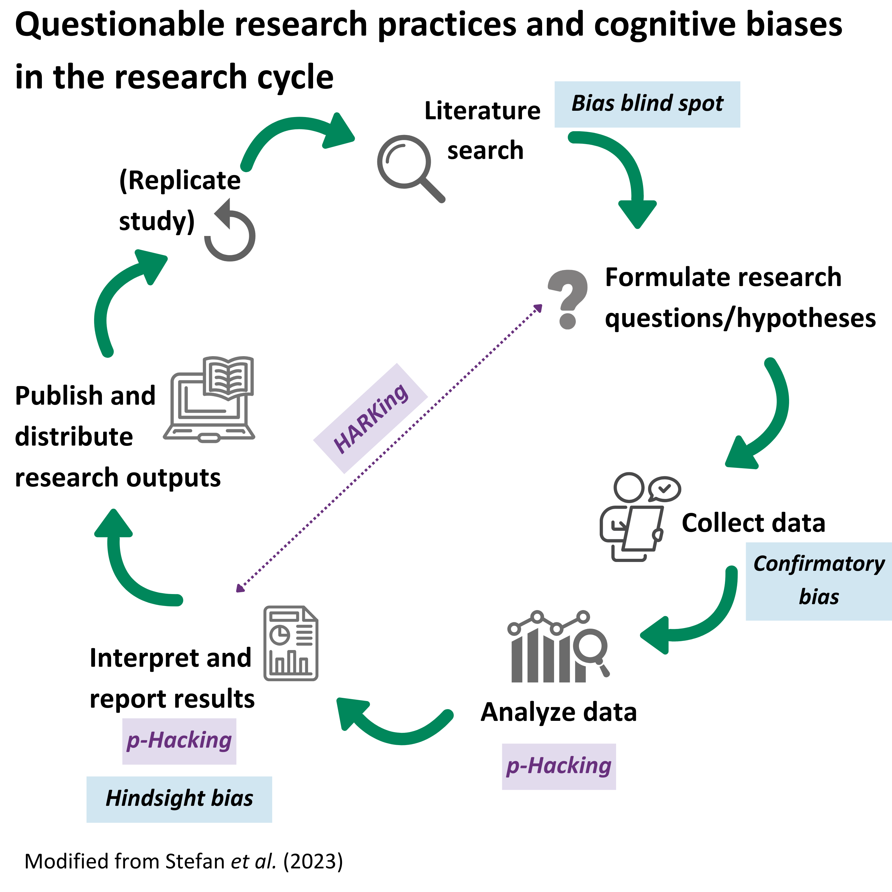
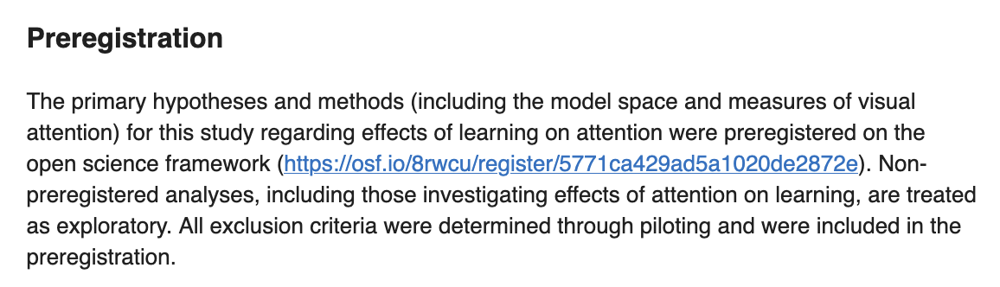
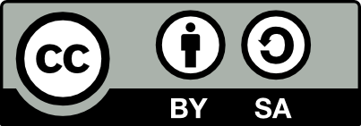

## Prerequisites

::: callout-important
Before completing this session, please carefully read about the
prerequisites.
:::

::: {style="font-size: 0.6em;"}
| Prerequisite | Description | Link/Where to find it |
|------------------------|------------------------|------------------------|
| Credible research | Introduction to concepts such as replicability, reproducibility as part of credible research | Access [here](https://lmu-osc.github.io/teaching-material-for-novices/open-research-principles/credible-research/) |
|  |  |  |
:::

::: footer
Add references in the footer.
:::

::: notes
**Presenter Notes**: These are the **presenter notes**. You will a
script for the presenter for every slide. In presentation mode, your
audience will not be able to see these presenter notes, they are only
visible to the presenter.

Add the script for this slide.

**Instructor Notes**: There are also **instructor notes**. For some
slides, there will be pedagogical tips, suggestons for acitivities and
troubleshooting tips for issues your audience might run into. You can
find these notes underneath the speaker notes.

These are the prerequisites for this topic. Before you get started on
this topic with your audience, you need to ensure that the audience
fulfills these criteria. Outline any essential prerequisites (software,
tools, other sessions etc.) here in table format. If you prefer bullet
points to list the prerequisites, delete the table and use bullet points
instead.

**Accessibility Tips**: Where applicable, this is a space to add any
tips you may have to facilitate the accessibility of your slides and
activities.
:::

------------------------------------------------------------------------

## Questions from the previous session

::: {style="background-color: #f0f0f0; padding: 0.1em; border-radius: 5px; font-size: 1em; text-align: center;"}
What are your open questions regarding the **Credible Research
session**?
:::

::: notes
**Presenter Notes**: As a reminder we are building on from the previous
session on credible research with a focus of how preregistration can
contribute to more transparent, rigorous and credible research.

What are your questions?

**Instructor Notes**: This first slide is dedicated to clarifying
questions from the previous session and/or to discuss assignments.

- Additional slides may need to be added depending on the nature of the
  homework assignments.
- Critical for the learning process to ensure that learners are on the
  same page and have been able to achieve the learning goals of the
  previous workshop.
- Not applicable if this set of slides corresponds to the first session
  of a new module.
:::

------------------------------------------------------------------------

## Before we start: Survey time!

::: panel-tabset
### Question 1

**What is your level of familiarity with preregistration (e.g., basic
concepts, terminology, or processes)?**

a.  I have never heard of it before.

b.  I have heard of it but have never worked with it.

c.  I have basic understanding and experience with it.

d.  I am very familiar and have worked with it extensively.

### Question 2

**How would you rate your confidence to carry out a preregistration for
your study?** (1 to 5 scale: **1** = Not confident at all, **2** =
Slightly confident, **3** = Somewhat confident, **4** = Very confident,
**5** = Completely confident)

a.  Not confident at all

b.  Slightly confident

c.  Somewhat confident

d.  Very confident

e.  Completely confident

### Question 3

**What words come to mind when you think of preregistration?**
:::

::: notes
**Presenter Notes**: Script for the slide here.

**Instructor Notes**: This survey serves to examine learners' prior
knowledge about the topic. For an interactive delivery, use free tools
such as for example [Particify](https://www.particify.de/en/) to create
interactive surveys with QR codes before you deliver this lesson. The
pre-session survey should serve to examine learners' prior knowledge
about version control and related concepts. Note that this survey cannot
be completed in an asynchronous setting because the survey results
cannot be displayed.
:::

------------------------------------------------------------------------

## Discussion of survey results

What do we see in the results?

::: notes
**Presenter Notes**: Let us have a look at these results.

**Instructor Notes**:

- **Aim**: Briefly examine the answers given to each question
  interactively with the group. Use visuals from the survey to highlight
  specific answers.

**Accessibility Tip**: Have people work in pairs if someone did not
bring their phone/does not have a phone. This survey also cannot be
completed in an asynchronous setting.
:::

------------------------------------------------------------------------

## Learning goals

**Aim**: Examine study preregistration as an open science practice, its
links to addressing questionable research practices and what components
make up a preregistration. <br> <br>

There are **two** sections to this session:

- **Section 1**: Introduction to study preregistration

- **Section 2:** How to do a study preregistration

::: notes
**Presenter Notes**:

As a reminder we are building on from the previous session on credible
research with a focus of how preregistration can contribute to more
transparent, rigorous and credible research.
:::

------------------------------------------------------------------------

## Section 1: Learning goals and overview

Section 1 is all about learning the key terms and definitions and to get
you thinking about the *what* and the *why* of study preregistration.
<br> <br>

Activity: Reflection question and quiz <br> <br>

After completing section 1 you should be able to:

- **Recognize** the context of why registration exists as an open
  science practice

::: notes
*Speaker Notes:*

After completing section 1 you should be able to:

- **Recognize** the context of why registration exists as an open
  science practice

The main activity is a self reflection exercise
:::

------------------------------------------------------------------------

## Section 2: Learning goals and overview

Section 2 is all about learning about the steps involved in a study
preregistration <br> <br>

After completing section 2 you should be able to:

- **Identify** the key components of a study preregistration
- **Describe** the differences between study preregistration and
  registered reports

::: notes
*Speaker Notes:*

After completing section 2 you should be able to:

- **Identify** the key components of a study registration
- **Describe** the differences between study registration and registered
  reports
:::

------------------------------------------------------------------------

## Section 1: Introduction to preregistration

::: notes
*Speaker notes:*

Let's start get started with section 1 where will look at the context of
why study preregistrations exist.
:::

------------------------------------------------------------------------

## Warm up question to get us started!

In your research project, when do you typically *think about* the type
of *analysis* you use?

- [ ] A. As you collect your data
- [ ] B. After you have collected all your data
- [ ] C. As you plan your study

1.  *Reflect* on the question on your own
2.  We will *share* our answers in class

::: notes
*Speaker Notes:*

To get us to think about our current ways of working, I would like us
think about our current or past research project and reflect on this
question: In your research project, when do you typically think about
the type of analysis you use?

A. As you collect your data B. After you have collected all your data C.
As you plan your study

We will then share our some of our thoughts as a class.

*Instructor Notes:*

*Activity delivery mode:* Suitable for in person, online and hybrid
teaching formats: Provide learners with a minute to think and then
submit their answers anonymously on a pre-prepared Particify poll.
Project the results of the question on the board/share screen (if
online). Remark on the most popular answer and invite 1 or 2 learners to
share their experiences related to the question if they feel comfortable
sharing.

*Pedagogical add on:* This self reflection question invites learners to
reflect on their own workflows. It also primes them for the practice of
registration being about reframing or front loading research planning in
advance of collecting data.
:::

------------------------------------------------------------------------

## A researcher’s freedom to decide

::: {style="font-size: 0.6em; margin-bottom: 0.5em;"}
:::

```{=html}

<div style="display: flex; align-items: flex-start; gap: 2em;">

  <!-- Left side: single image -->
  <div style="flex: 1; text-align: center;">

    
  
  </div>
  
```

<!-- Left side: bullet points -->

::: {style="flex: 1.3;"}
- Researchers make lots of decisions throughout the life cycle of a
  project like:

  - Which hypotheses to test?

  - How big a sample size is needed?

  - How long should the data collection period be?

  - Which statistical test(s) is most appropriate?


- Because of the great flexibility in how research can be conducted
  (known as **researcher degrees of freedom**), *how* and *when* we make
  these decisions matters for the credibility of science.
:::

</div>


::: notes
*Speaker Notes:*

As researchers we make lots of decisions throughout the life cycle of a
research project: Which hypotheses to test? How big a sample size is
needed? How long should the data collection period be? Which statistical
test(s) is most appropriate?

Because of the great flexibility in how research can be conducted (known
as researcher degrees of freedom), how and when we make these decisions
matters for the credibility of science.
:::

------------------------------------------------------------------------

## Researcher degrees of freedom

- Generally researchers accept a **5% false-positive** rate (p ≤ .05)
  when testing a hypothesis [@simmons2011].

- When researchers make decisions on analyses **after** seeing the data,
  this **increases** the **false positive rate.**

- Possible researcher decisions that inflate false-positive rate:

  - **Increasing** our sample size N after failure
  - **Removing** outliers after seeing their effect
  - **Post-hoc** categorizing or transforming predictors
  - **Removing** a treatment category
  - **Adding** baseline measures as covariate
  - **Controlling** for covariates or interaction terms

::: notes
*Speaker Notes:* Generally in quantitative research, we accept a 5%
false-positive rate (p ≤ .05) when testing a hypothesis. In other words,
20 attempts to investigate a false hypothesis will result in one
statistical result. In practical terms, the more statistical tests we do
the more likely we are to falsely find a statistically significant
result.

The following examples of researcher decisions which increase the rate
of false positives: **Increasing** our sample size N after failure,
**removing** outliers after seeing their effect, **Post-hoc**
categorizing or transforming predictors, **removing** a treatment
category, **adding** baseline measures as covariate, **controlling** for
covariates or interaction terms

*Instructor Notes:*

It can be helpful to provide a worked example highlighting how
researcher degrees of freedom inflate false positive rate.

This example has been adapted from Forstmeier et al. (2017):

Say you are trying to test whether female bird species X prefer males
with larger feathers. You are unsure of the effect size or how big a
sample size to collect, so you begin with collecting data on 10 females.
With the sample size of 10 you run a simple regression to test whether
feather length predicts female response Y. The regression reveals a
trend showing females have a slight preference for larger feathers, but
this result is not statistically significant. You are drawn to the
result and think that a significant result can be reached by increasing
the statistical power. You decide to collect more data on 10 more
females, as a way to improve the statistical power, and rerun your
regression with the 20 females.

In pursuit of the significant result, you have inadvertently increased
your false positive rate from 5% to \~7.7% (based on Simmons et al.
(2011) false positive simulation study). This occurred because the two
datasets were combined in the analysis and therefore are not independent
resulting in an increased chance of reaching a significant result. The
risk of reaching a false positive finding increases the more times you
cycle through data collection and significance testing then collecting
more data and so on. This is why a data collection stopping rule decided
in advance during the study design stage!
:::

------------------------------------------------------------------------

## Questionable research practices

- Questionable research practices (QRPs) are a set of *intentional* or
  *unintentional* behaviors where researchers distort study findings.
  Examples include p-hacking and HARKing [@parsons2022]

::: callout-note
## Definitions

- **HARKing**: Hypothesizing after the results are known (HARKing) is a
  QRP where a researcher changes their hypothesis based on or informed
  by the results, but present their hypothesis as if it were a priori
  [@kerr1998].
- **p-Hacking**: A QRP which describes the many ways researchers can
  artificially increase the likelihood of obtaining a statistically
  significant result [@pennington2023].
:::

::: notes
*Presenter notes:*

Questionable research practices often shortened to QRPs are a set of
*intentional* or *unintentional* behaviors where researchers distort
study findings. Examples include p-hacking and HARKing

- HARKing: Hypothesizing after the results are known (HARKing) is a QRP
  where a researcher changes their hypothesis based on or informed by
  the results, but present their hypothesis as if it were a priori.

- p-Hacking: A QRP which describes the many ways researchers can
  artificially increase the likelihood of obtaining a statistically
  significant result
:::

------------------------------------------------------------------------

## Researcher biases

- There are wide range of *cognitive biases* (e.g. hindsight bias,
  confirmatory bias, bias blind spot) that lead to systematic
  differences in how we perceive information and make decisions.

- It highlights that we are all human and it is important to be *aware*
  of how cognitive biases *influence* how we do our research!

::: callout-note
## Definitions

- **Hindsight bias**: The tendency to frame *previous* decisions or
  events as *more predictable* after the outcome is known ("I knew it
  all along") [@hardwicke2023].
- **Confirmatory bias**: The tendency to seek out, interpret, favor and
  recall information in a way that *supports* one’s *prior* values,
  beliefs, expectations, or hypothesis [@parsons2022].
- **Bias blind spot**: The *lack of awareness* of how one's decisions
  are shaped by bias [@hardwicke2023].
:::

::: notes
*Presenter notes:*

Biases are another big influence on how we perceive information and
decision-making during the research process!

Here we outline 3 main ones that are relevant to the topic of study
registrations.

- Hindsight bias: The tendency to frame *previous* decisions or events
  as *more predictable* after the outcome is known ("I knew it all
  along")
- Confirmatory bias: The tendency to seek out, interpret, favor and
  recall information in a way that *supports* one’s *prior* values,
  beliefs, expectations, or hypothesis
- Bias blind spot: The *lack of awareness* of how one's decisions are
  shaped by bias

*Instructor notes:*

Remind learners know that biases are a part of being human and awareness
is key!
:::

------------------------------------------------------------------------

## Questioning how we do research

{fig-alt="A screenshot of journal articles highlighting the credibility crisis over the last two decades."
fig-align="center" width="430"}

::: notes
*Presenter notes:*

A core role of a scientist is to discover truths about how the world
works. We can generate hypotheses, collect data, then examine the data
and interpret findings in relation to our hypotheses to hopefully build
more theories about how the world works.

Research is built on prior findings. The publication of false positive
findings due to questionable research practices has implications within
and beyond academic research. It can lead to incorrect conclusions
potentially resulting in wasted resources for researchers inspired to
build upon the (incorrect) findings. This can also result in ineffective
policy recommendations or even harmful medical interventions
:::

------------------------------------------------------------------------

## Preregistration as part of the credibility revolution

- A strategy to address the “crisis” is the practice of preregistration.
  Preregistrations aim to: reduce risk of false positive findings by
  *safe guarding* researchers from questionable research practices and
  biases by making decision-making processes more explicit.
- It involves uploading a time-stamped, publicly-available record of a
  research study plan onto a register, which is given a unique and
  permanent study identifier [@nosek2018;@pennington].

::: callout-note
## Terminology

The term *study registration* is used here instead of "preregistration"
which can be ambiguous as it can refer to different practices occurring
at various stages of the research life cycle [@mayo-wilson2025]
:::

------------------------------------------------------------------------

## History of preregistrations

- The concept of preregistration is not new! The scientist and
  philosopher Charles Sanders Peirce in \~1880s created a set of rules
  to test "the truth", with one being that hypotheses should be stated
  *before* data collection [@peirce1883].

- One of the earliest formal implementations of registrations comes from
  medical *clinical trials*. More recently, *researchers* and *journals*
  in the field of *psychology* have rapidly adopted this practice

::: callout-tip
## Did you know?

The percentage of medical study findings reporting a significant benefit
for an intervention dropped by \~50% after the year 2000 when the
registry for clinical trials -
[clinicaltrials.gov](https://clinicaltrials.gov/) was launched
[@kaplan2015]!
:::

::: notes
*Speaker Notes:*

Study registration might seem like a hot topic nowadays but the concept
is not new!

- The scientist and philosopher Charles Sanders Peirce around 1880s
  created a set of rules to test "the truth", with one being that
  hypotheses should be stated *before* data collection.

- One of the earliest formal implementations of registrations comes from
  medical *clinical trials*.

- More recently, *researchers* and *journals* in the field of
  *psychology* have rapidly adopted this practice
:::

------------------------------------------------------------------------

## Preregistrations and research approaches

- There is greater awareness and uptake of preregistrations in the
  social sciences and quantitative research approaches
  [@pennington2026].

- Preregistration is relevant to many other methods including:

  - **Qualitative** for example studies based on interviews, focus
    groups, ethnographic accounts

  - **Review-based** for example systematic and narrative reviews

  - **Observational** for example case studies, natural experiments,
    longitudinal studies

::: callout-note
This session focuses more on quantitative, for guidance on
preregistration on qualitative research see @haven2020.
:::

::: notes
*Speaker Notes:*

There is greater awareness and uptake of preregistrations in the social
sciences and quantitative research approaches.

Preregistration is relevant to many other methods including:

- **Qualitative** for example studies based on interviews, focus groups,
  ethnographic accounts
- **Review-based** for example systematic and narrative reviews
- **Observational** for example case studies, natural experiments,
  longitudinal studies
:::

------------------------------------------------------------------------

## Summary of section 1

::: {style="font-size: 0.6em; margin-bottom: 0.5em;"}
:::

```{=html}

<div style="display: flex; align-items: flex-start; gap: 2em;">

  <!-- Left side: single image -->
  <div style="flex: 1; text-align: center;">

    
  
  </div>
  
```

<!-- Left side: bullet points -->

::: {style="flex: 1.3;"}
- There is great flexibility in decisions researchers make during the
  life-cycle of a project

- Questionable research practices (QRPs) and biases may not be
  intentional yet they influence the rate of false-positive findings

- False-positive findings hinder scientific progress from wasting
  resources to potentially harmful policy recommendations

- Preregistration is a practice that aims to mitigate QRPs by
  transparently documenting a research plan
:::

</div>

::: notes
*Speaker Notes:*

:::

------------------------------------------------------------------------

## Quiz

------------------------------------------------------------------------

**Q1. HARKing - Hypothesizing after the results are known is a:**

- [ ] A. type of cognitive bias
- [ ] B. questionable research practice
- [ ] C. name of a website to report research misconduct

::: notes
*Speaker Notes:*

Question 2: HARKing - Hypothesizing after the results are known is a

A. cognitive bias B. questionable research practice C. name of a website
to report research misconduct
:::

------------------------------------------------------------------------

**A1. HARKing - Hypothesizing after the results are known is a:**

- [ ] A. type of cognitive bias
- [x] B. questionable research practice
- [ ] C. name of a website to report research misconduct

::: notes
*Speaker Notes:*

The correct answer is B, HARKing is a questionable research practice.
:::

------------------------------------------------------------------------

**Q2. The tendency to frame *previous* decisions or events as *more
predictable* after the outcome is known, is an example of which type of
cognitive bias?**

- [ ] A. confirmatory bias
- [ ] B. bias blind spot
- [ ] C. hindsight bias

::: notes
*Speaker Notes:*

Question 3: The tendency to frame *previous* decisions or events as
*more predictable* after the outcome is known, is an example of which
type of cognitive bias?

A. confirmatory bias B. bias blind spot C. hindsight bias
:::

------------------------------------------------------------------------

**A2. The tendency to frame *previous* decisions or events as *more
predictable* after the outcome is known, is an example of which type of
cognitive bias?**

- [ ] A. confirmatory bias
- [ ] B. bias blind spot
- [x] C. hindsight bias

The answer is C. Hindsight bias can be summarized as "I knew it all
along" type of thinking.

::: notes
*Speaker Notes:*

The answer is C. Hindsight bias can be summarized as "I knew it all
along" type of thinking.
:::

------------------------------------------------------------------------

**Q3. Which statement below about study registrations is FALSE?**

- [ ] A. Study registrations are only relevant in medical research
  studies
- [ ] B. Study registrations can safe guard against researcher cognitive
  biases
- [ ] C. Study registrations help differentiate between confirmatory and
  exploratory analysis

::: notes
*Speaker Notes:*

Question 4: Which statement below about study registrations is FALSE?

A. Study registrations are only relevant in medical research studies B.
Study registrations can safe guard against researcher cognitive biases
C. Study registrations help differentiate between confirmatory and
exploratory analysis
:::

------------------------------------------------------------------------

**A3. Which statement below about study registrations is FALSE?**

- [x] A. Study registrations are only relevant in medical research
  studies
- [ ] B. Study registrations can safe guard against researcher cognitive
  biases
- [ ] C. Study registrations help differentiate between confirmatory and
  exploratory analysis

The answer is A, although study registrations were first formally
implemented in medical research studies, this practice is relevant to
many fields and research approaches and increasingly encouraged by
journals!

::: notes
*Speaker Notes:*

The answer is A, although study registrations were first formally
implemented in medical research studies, this practice is relevant to
many fields and research approaches and increasingly encouraged by
journals!
:::

------------------------------------------------------------------------

## Section 2: How to do a study preregistration

::: notes
*Speaker Notes:*

In section 1 we covered the context and rationale of study
registrations, now in section 2 we will learn what the practical steps
involved are what information is needed to complete a study
registration.
:::

------------------------------------------------------------------------

## Study preregistration steps

There are a number of **essential** and a subset of **recommended**
elements to include in a preregistration [@stefan2023]:

1.  Hypotheses
2.  Design
3.  Planned sample
4.  Exclusion criteria
5.  Analysis plan

::: callout-tip
Think about the steps of doing a study registration like a recipe for a
cake! All the ingredients and methods should be clearly written so
another person can follow. If steps are unclear or missing the resulting
cake will look and taste different.
:::

::: notes
*Speaker Notes:*

There are five essential elements that go into a study registration
(hypotheses, design, planned sample, exclusion criteria and analysis
plan). These mirror some of the stages in the research life cycle we
have seen earlier. There are also additional recommendations that can be
added to registrations.

We will go through each element in turn.

It can be helpful to think about the steps involved in doing a study
registrations like a a recipe for a cake! All the ingredients and
methods should be clearly written so another person can follow. If steps
are unclear or missing the resulting cake will look and taste different.

*Instructor Notes:*

Sharing analogies like study registrations as following a cake recipe
can be helpful for learners to relate to seemingly abstract concepts in
a more familiar way.

It is advisable to share with learners, the steps outlined over the next
couple slides are more focused for hypothesis-testing research. Study
registrations for hypothesis-generating or exploratory research, exist
(e.g. see also Dirnagl (2020))

Dirnagl, U. (2020) Preregistration of exploratory research: Learning
from the golden age of discovery. PLoS Biol 18(3): e3000690.
https://doi.org/10.1371/journal.pbio.3000690
:::

------------------------------------------------------------------------

## Part 1: Hypotheses

[Essential:]{style="background-color: #30a347; color: #fcfcfd; padding: 3px 6px; border-radius: 4px;"}

- *State* your research questions clearly
- *Describe* the (numbered) hypotheses in the context of your variables
- For interaction effects, *describe* the expected shape of the
  interactions.
- If you are manipulating a variable, *make predictions* for successful
  check variables or explain why no manipulation check is included.

[Recommendations:]{style="background-color: #2b66ff; color: #FAF9F6; padding: 3px 6px; border-radius: 4px;"}

- Adding a table/figure to describe complex interaction
- For studies testing hypotheses, link stated hypotheses to theoretical
  frameworks

::: notes
*Speaker Notes:*

Essential things to include when stating hypotheses: a clearly stated
research question from which the hypotheses are linked and described in
detail.

For interaction effects, *describe* the expected shape of the
interactions. If you are manipulating a variable, *make predictions* for
successful check variables or explain why no manipulation check is
included.
:::

------------------------------------------------------------------------

## Hypothesis generating vs testing

- Hypothesis *generating* vs *testing* are two modes of research inquiry
  that influence study designs and underpin the practice of study
  registrations

- Hypothesis generating:

  - exploratory, discovery-focused research (asks questions like: what
    is happening? Why is it happening, How is it happening?)

- Hypothesis testing:

  - confirmatory, justification-focused research (asks questions like:
    what does X do to Y?)

::: callout-note
The *distinctions* between hypothesis generating vs testing research are
often not clearly differentiated in *practice*, which leads to
*questionable research practices* and *reduced credibility* of research
[@nosek2018].
:::

::: notes
*Speaker notes:* Hypothesis *generating* vs *testing* are two modes of
research inquiry that influence study designs and underpin the practice
of study registrations

- Hypothesis generating:
  - also referred to as exploratory or discovery-focused research (asks
    questions like: what is happening? Why is it happening, How is it
    happening?)
- Hypothesis testing:
  - also known as confirmatory or justification-focused research (asks
    questions like: what does X do to Y?)
:::

------------------------------------------------------------------------

## Part 2: Design

[Essential:]{style="background-color: #30a347; color: #fcfcfd; padding: 3px 6px; border-radius: 4px;"}

- *List* of variables based on your hypotheses:
- Independent variables (including levels, within or between
  participants, relationship between them (e.g. nested))
- dependent variables or variables in a correlational design
- third variables (e.g. covariates, moderators, control variables)

::: notes
*Speaker Notes:*

An essential element to document for study designs: Is clearly listing
variables based on your hypotheses, which include:

\- Independent variables (including levels, within or between
participants, relationship between them (e.g. nested))

\- dependent variables or variables in a correlational design

\- third variables (e.g. covariates, moderators, control variables)
:::

------------------------------------------------------------------------

## Part 3: Planned sample

[Essential:]{style="background-color: #30a347; color: #fcfcfd; padding: 3px 6px; border-radius: 4px;"}

- If applicable, *state* any pre-selection rules (e.g. age limits)
- *Indicate* where, from whom and how the data will be collected
- *Justify* planned sample size (e.g. power analysis)
- *Describe* data collection termination rule

::: notes
*Speaker Notes:*

When documenting planned sampling protocols any pre-selection rules
(e.g. age limits) should be stated, if applicable. Information (where?,
how? and who?) about data collection methods.

The planned sample size needs to be justified and the data collection
termination rule described.
:::

------------------------------------------------------------------------

## Part 4: Exclusion criteria

[Essential:]{style="background-color: #30a347; color: #fcfcfd; padding: 3px 6px; border-radius: 4px;"}

- *Describe* anticipated specific data exclusion criteria such as:
- missing, erroneous, or overly consistent responses
- failing check-tests or suspicion probes
- demographic exclusions
- data-based outlier criteria (e.g expected variable ranges)
- method-based outlier criteria (e.g. too short or long response times)

[Recommendations:]{style="background-color: #2b66ff; color: #FAF9F6; padding: 3px 6px; border-radius: 4px;"}

- *Set* fail-safe levels of exclusion at which the whole study needs to
  be stopped, altered, and restarted.

::: notes
*Speaker Notes:*

When it comes to exclusion criteria, the following should be described:
how will you deal with missing, erroneous, or overly consistent
responses?

More pertinent for human-centered data collection, is how failing
check-tests or suspicion probes and how demographic exclusions will be
dealt with.

Outlier criteria related to data (e.g. state reasonable range of a
variable like an age of 140 would be excluded) and methods (e.g.too
short or long response times)

A recommendation is to set fail-safe levels of exclusion at which the
whole study needs to be stopped, altered, and restarted.
:::

------------------------------------------------------------------------

## Part 5: Analysis plan

[Essential:]{style="background-color: #30a347; color: #fcfcfd; padding: 3px 6px; border-radius: 4px;"}

- *Describe* the analyses that will test each main prediction from the
  hypotheses section. For each one, include:
- relevant variables and how they are calculated
- statistical technique
- each variable’s role in the technique (e.g., independent variable,
  dependent variable and covariates)
- rationale for each covariate used, if any
- if using techniques other than null hypothesis testing (e.g. Bayesian
  statistics), describe your criteria calculation of prior values or
  distributions

::: notes
*Speaker Notes:*

In an analysis plan, it is essential to include descriptions of the
analyses that will be done and how they relate to the predictions
outlined in the hypothesis section. The statistical techniques need to
be described and how each variable is calculated and how each variable
(independent, dependent and covariate) relates to the statistical
approach outlined. If covariate are included, their rational should be
stated.

In the case where Bayesian statistics are used, calculation of prior
values or distributions should be outlined.

*Instructor Notes:*

Instructors can pause at the end of this slide and remind students to
recall the reflection question at the beginning - when do you think
about what data analysis you will do? By bridging the prior activity
with this analysis plan checklist for a study registration it can help
learners reflect and identify their own knowledge gaps.

Instructors can ask learners to do a show of hands to the question of
would you change your answer going forward? (i.e. if their answers have
changed based on learning about analysis plans?).
:::

------------------------------------------------------------------------

## Part 5: Analysis plan continued

[Recommendations:]{style="background-color: #2b66ff; color: #FAF9F6; padding: 3px 6px; border-radius: 4px;"}

- *Specify* contingencies and assumptions (e.g. method of correcting for
  multiple testing, missing data handling, data transformations,
  assumptions and assumption checks for analyses and alternative plans
  for data analysis if assumptions are not met).

::: notes
*Speaker Notes:*

If possible it is recommended that you specify contingencies and
assumptions such as missing data and data transformations (e.g.
Shapiro-Wilk's test for normal/Gaussian distribution)
:::

------------------------------------------------------------------------

## Additional considerations

Additional things to keep in mind as you plan your study.

Determine if you need to:

- plan for multi-stage contingent experiments
- anonymize your registration (e.g. place under embargo)
- apply for ethical approval

::: notes
*Speaker Notes:*

Other things that are important to consider whilst putting together a
study registration is whether your study requires anonymization (e.g.
place under embargo) or if ethical approval is needed.
:::

------------------------------------------------------------------------

## Preregistration templates

::: {style="font-size: 0.6em; margin-top: 0.5em;"}
<em>Adapted from @pennington; @stewart </em>
:::

:::::: {style="display: flex; gap: 0.5em;"}
::: {style="flex: 0.75;"}
**Template**

- [AsPredicted](https://aspredicted.org/)
- Open Science Framework
  [(OSF)](https://help.osf.io/article/330-welcome-to-registrations)
- [PROSPERO](https://www.crd.york.ac.uk/prospero/)
- [Preregistration in social psychology](https://osf.io/k5wns/overview)
- [Bio-protocol](https://bio-protocol.org/exchange)
- [preregRS](https://onlinelibrary.wiley.com/doi/10.1002/jrsm.1540)
:::

::: {style="flex: 1;"}
**Description**

- Standardized template
- Multiple templates for many study types
- Study protocols for systematic reviews
- Guidelines
- Online peer-reviewed protocol journal
- Guidelines
:::

::: {style="flex: 1.1;"}
**Discipline/study type**

- Quantitative/experimental studies
- Wide-ranging
- Health related
- Quantitative/experimental social psychology studies
- Biological sciences
- Research syntheses
:::
::::::

::: notes
*Speaker Notes:*

Now that you have an overview of what things are needed in a study
preregistration, we can look at this table which displays a non
exhaustive list of templates.

The template you need will depend on the type of research study,
institutional policies or any community standards.
:::

------------------------------------------------------------------------

## Registered reports

- An extension of preregistration where a study undergoes two stages of
  peer review [@chambers2013]:

:::::: incremental
::::: columns
::: column
**Stage 1**

- Authors submit a manuscript detailing the study background, design,
  data collection and analysis plan.

- Following peer review, a manuscript is either rejected or
  "in-principle accepted"

- Authors then conduct the study, analyse and write up their findings
  according to their plan.
:::

::: column
**Stage 2**

- Authors are assessed on whether they have adequately followed their
  study plan and reported deviations where appropriate.

- The manuscript will then be published independent from the statistical
  significance (or lack of) of the findings.
:::
:::::
::::::

::: notes
*Speaker Notes:* So far we have focused on preregistration, but there is
another related Open Science practice known as a registered report.
Registered reports are a publishing format where a study undergoes two
stages of peer review: stage 1: introduction and methods in advance of
data collection/analysis and stage 2: which includes the full study
findings including results/discussion.

At stage 1, authors submit a manuscript detailing the study background,
research design, data collection strategy, analysis plan. Following peer
review a manuscript will either be rejected and or accepted - where a
manuscript will have “in-principle acceptance” status. Authors then
proceed to conduct the study, analyse and write up their findings
according to their study plan.

During stage 2, authors are assessed on whether they have adequately
followed their study plan and reported deviations where appropriate. The
manuscript will then be published independent from the statistical
significance (or lack of) of the findings.
:::

------------------------------------------------------------------------

## Registered reports

The benefits of registered reports:

- allows for potential errors to be detected early before data
  collection

- mitigates against publication bias

::: callout-note
Registered reports have been described in the literature as "Two-stage
review with in-principle acceptance" [@mayo-wilson2025].
:::

::: notes
*Speaker Notes:* This process allows for potential errors to be detected
early before data collection and mitigates against publication bias.
:::

------------------------------------------------------------------------

## Post preregistration

- When it comes to write up your research findings for publication:

::: {style="font-size: 0.6em; margin-bottom: 0.5em;"}
<em> Study preregistration statement from @wise2019 </em>
:::

```{=html}

<div style="display: flex; align-items: flex-start; gap: 2em;">

  <!-- Left side: single image -->
  <div style="flex: 1; text-align: center;">

    
  
  </div>
  
```

<!-- Right side: bullet points -->

::: {style="flex: 1;"}
- *check* which journals accept study registrations (see "guide for
  authors" on journal sites)
- *include* a statement to say which aspect of the work was registered
- *state* if any additional (e.g. exploratory) analyses not already
  reported were conducted
- *provide* a link to the registry used (e.g. OSF)
:::

</div>

::: notes
*Speaker Notes:*

If you are not going down the registered report publishing pathway, when
it comes to publishing the researching findings after submitting a study
registration, first check the journal you are submitting to, accepts
study registrations. Acceptance of study registrations is increasing!

Remember to add a statement on your manuscript about which elements of
your study has been registered. Note, you may have to check a box on the
journal submission page declaring you have registered your study.

See the example study registration statement here.
:::

------------------------------------------------------------------------

## Quiz time!

Time to test your knowledge on preregistration

------------------------------------------------------------------------

## Question 1

**True or false? When describing your design plan you *only* need to
describe your independent and dependent variables.**

- [ ] True
- [ ] False

::: notes
*Speaker Notes:*

Question number 1: True or false? When describing your design plan you
only need to describe your independent and dependent variables
:::

------------------------------------------------------------------------

## Question 1 answer

**True or false? When describing your design plan you *only* need to
describe your independent and dependent variables.**

- [ ] True
- [x] False

::: callout-note
If your study has any covariates, these should be listed too!
:::

::: notes
*Speaker Notes:*

The answer is false, as covariates should be listed too.
:::

------------------------------------------------------------------------

## Question 2

**True or false? Study registration involves stating *how* you will
handle missing data**

- [ ] True
- [ ] False

::: notes
*Speaker Notes:*

Question number 2: True or false? Study registration involves stating
how you will handle missing data
:::

------------------------------------------------------------------------

## Question 2 answer

**True or false? Study registration involves stating *how* you will
handle missing data**

- [x] True
- [ ] False

::: notes
*Speaker Notes:*

The answer is true.
:::

------------------------------------------------------------------------

## Question 3

**Which repository has a more *generalist* study registration
template?**

- [ ] A. PROSPERO
- [ ] B. OSF
- [ ] C. Bio-protocol

::: notes
*Speaker Notes:*

Question 3:

Which repository has a more generalist Study registration template?

A. PROSPERO B. Open Science Framework (OSF) C. Bio-protocol
:::

------------------------------------------------------------------------

## Question 3 answer

**Which repository has a more *generalist* Study registration
template?**

- [ ] A. PROSPERO
- [x] B. Open Science Framework (OSF)
- [ ] C. Bio-protocol

::: callout-note
OSF contains multiple templates for different study types including for
qualitative, quantitative and systematic review studies, which can be
adapted. See OSF help page
[here](https://help.osf.io/article/330-welcome-to-registrations#Select-a-Registration-Template-1g4YO).
:::

::: notes
*Speaker Notes:*

The answer is OSF, which contains multiple templates for different study
types including for qualitative, quantitative and systematic review
studies, which can be adapted.

If you follow the hyper link it will take you to the OSF help page which
breaks down the different templates with example use cases.
:::

------------------------------------------------------------------------

## Question 4

**Registered reports have two peer review stages that occur:**

- [ ] A. *After* developing an idea and *after* writing up study
  findings
- [ ] B. *After* study plan and *after* collecting and analyzing data
- [ ] C. *After* study plan and *after* writing up study findings

::: notes
*Speaker Notes:*

The final question: Registered reports have two peer review stages that
occur:

A. *After* developing an idea and *after* writing up study findings B.
*After* study plan and *after* collecting and analyzing data C. *After*
study plan and *after* writing up study findings
:::

------------------------------------------------------------------------

## Question 4 answer

**Registered reports have two peer review stages that occur:**

- [ ] A. *After* developing an idea and *after* writing up study
  findings
- [ ] B. *After* study plan and *after* collecting and analyzing data
- [x] C. *After* study plan and *after* writing up study findings

::: notes
*Speaker Notes:*

The answer is C to when peer review occurs in registered reports
(*after* study plan and *after* writing up study findings)
:::

------------------------------------------------------------------------

## Final summary and take home

There is no single "right" way to design or analyze/interpret a research
study. It is important to be able to recognize your research approach
and the steps involved from having an idea to sharing your research
findings.

::: callout-tip
## Tip with Title

EDIT
:::

::: notes
**Presenter Notes**: Script for the slide here.

**Instructor Notes**:

- **Aim**: Provide overview of the topics covered today and remind
  learners of the bigger picture.
:::

------------------------------------------------------------------------

## Learning objectives: Check-In

**Where are we at?**

::: incremental
- [ ] **Recognize** the context of why registration exists as an open
  science practice
- [ ] **Identify** the key components of a study preregistration
- [ ] **Describe** the differences between study preregistration and
  registered reports
:::

::: notes
**Presenter Notes**: Let us pause for a quick check-in. Take a moment to
look back at the learning objectives and reflect on how comfortable you
feel with each one.

If you notice any gaps, this is the right moment to bring them up. Feel
free to ask questions or start a discussion so we can address them
before moving on.

**Instructor Notes**: Use this slide to encourage self-reflection rather
than evaluation. Emphasize that learners are not expected to feel
equally confident about all objectives at this stage. Keep the
discussion supportive and brief, focusing on clarifying concepts rather
than introducing new material.
:::

------------------------------------------------------------------------

## Assignment EDIT

- **Aim**: Explain the homework assignment and the rationale behind the
  homework.
- Examine whether/how it will be assessed
- Mention scoring rubrics, if applicable
- Design a peer-review system for assignments to place learners in role
  of reviewer and author

::: notes
**Presenter Notes**: Script for the presentation here.

**Instructor Notes**:

- **Aim**: Explain the homework assignment and the rationale behind the
  homework.

- Examine whether/how it will be assessed

- Mention scoring rubrics, if applicable

- Design a peer-review system for assignments to place learners in role
  of reviewer and author
:::

------------------------------------------------------------------------

## To conclude: Survey time!

::: panel-tabset
### Question 1

**What is your level of familiarity with preregistration (e.g., basic
concepts, terminology, or processes)?**

a.  I have never heard of it before.

b.  I have heard of it but have never worked with it.

c.  I have basic understanding and experience with it.

d.  I am very familiar and have worked with it extensively.

### Question 2

**How would you rate your confidence to carry out a preregistration for
your study?** (1 to 5 scale: **1** = Not confident at all, **2** =
Slightly confident, **3** = Somewhat confident, **4** = Very confident,
**5** = Completely confident)

a.  Not confident at all

b.  Slightly confident

c.  Somewhat confident

d.  Very confident

e.  Completely confident

### Question 3

**What words come to mind when you think of preregistration?**
:::

::: notes
**Presenter Notes**: Script for the slide here.

**Instructor Notes**:

- **Aim**: This post-session survey serves to examine learners' current
  knowledge about the sumodule's topic.

- Use free survey software such as particify or formR to establish the
  following questions (shown on separate slides)

- Use identical questions as in the pre-session survey to be able to
  directly compare
:::

------------------------------------------------------------------------

## Discussion of survey results

<br>

::: {style="background-color: #f0f0f0; padding: 0.1em; border-radius: 5px; font-size: 1em; text-align: center;"}
What do we see in the results?
:::

::: notes
**Presenter Notes**: Script for the slide here.

**Instructer Notes**:

- **Aim**: Briefly examine the answers given to each question
  interactively with the group.

- Compare and highlight specific differences in answers between pre- and
  post-survey answers
:::

------------------------------------------------------------------------

## References

::: {#refs}
:::

::: notes
**Presenter Notes**: Script for the slide here.

**Instructor Notes**: Highlight particularly relevant reading for your
learners in bold.
:::

------------------------------------------------------------------------

## Additional resources

The Open Science Framework have created a detailed practical
[guide](https://help.osf.io/article/330-welcome-to-registrations) on how
to prepare a preregistration from creating, managing, submitting and
updating a preregistration.

------------------------------------------------------------------------

## Contribution statement

**Creator**: Middleton, Lil Sara
({fig-alt="orcid logo"}
[0000-0001-5307-8029](https://orcid.org/0000-0001-5307-8029))

**Reviewer**: Ihle, Malika
({fig-alt="orcid logo"}
[0000-0002-3242-5981](https://orcid.org/0000-0002-3242-5981))

------------------------------------------------------------------------

## Licence and citation statement

<br>

<p style="text-align:center;">



</p>

::: {style="background-color: #f0f0f0; padding: 0.05em; border-radius: 2px; font-size: 0.6em;"}
This current work by Sara Lil Middleton and Malika Ihle is licensed
under a CC-BY-SA 4.0 [Creative Commons Attribution 4.0 International SA
License](https://creativecommons.org/licenses/by-sa/4.0/deed.en). Code
snippets are dedicated to the public domain and are licensed under a
[Creative Commons Universal
License](https://creativecommons.org/publicdomain/zero/1.0/) (CC0 1.0).

Please cite these materials as: Sara Lil Middleton & Malika Ihle (2026).
*Preregistration part I: introduction and how to guide* \[Quarto
slides\]. [LMU Open Science Center](https://www.osc.lmu.de/).
<https://lmu-osc.github.io/teaching-material-for-novices/open-research-tools/preregistration-part-I>
:::

::: notes
**Presenter Notes**: The [Creative Commons Attribution 4.0 International
SA License](https://creativecommons.org/licenses/by-sa/4.0/deed.en), or
CC BY-SA 4.0, allows others to copy, share, and adapt a work in any
medium, including for commercial purposes. These permissions are broad
and cannot be withdrawn as long as the license terms are followed. The
main requirement is attribution: users must give appropriate credit to
the original creator, provide a link to the license, and clearly
indicate whether any changes were made, without implying endorsement by
the original author. In addition, the ShareAlike condition means that if
someone modifies or builds upon the work, the resulting material must be
distributed under the same CC BY-SA 4.0 license, or a compatible one.
Finally, users are not allowed to apply legal or technical restrictions,
such as DRM, that would prevent others from exercising these same
rights.

Code snippets are dedicated to the public domain and licensed under a
CC0 1.0 [Creative Commons Universal
License](https://creativecommons.org/publicdomain/zero/1.0/). You may
use, modify, distribute, and sell the code snippets for any purpose,
without permission or attribution. The code snippets are provided “as
is”, without warranty of any kind.
:::

------------------------------------------------------------------------

# End of slide deck

------------------------------------------------------------------------
